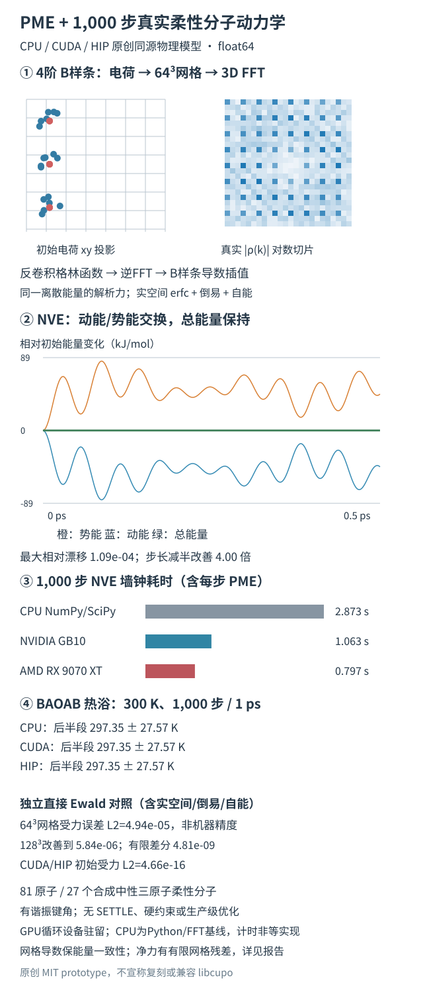
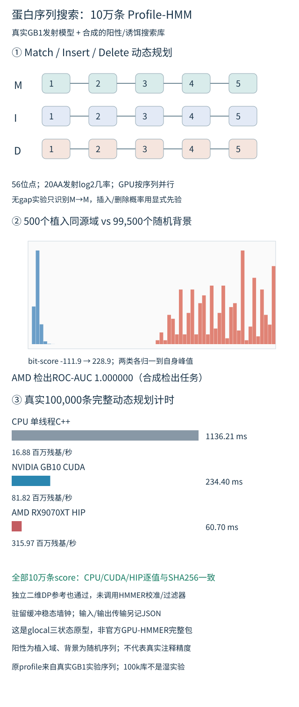

# AI for Science on CUDA-X & AMD HIP：从科学库 (`RDKit` / `Biopython`)、分子/蛋白质专有模型微调 (`Uni-Mol` / `ESM-2`) 到 `CUDA-X` (`cuSpa` / `open-cupotential`) 双平台真机实测

本项目在 **`NVIDIA DGX Spark`（`GB10` `sm_121` Blackwell，128GB 统一内存）** 与 **`AMD Radeon RX 9070 XT`（`gfx1201` RDNA4，16GB，Windows 11 + ROCm 10.2 `HIP`）** 双平台上，完整跑通并解剖了现代 **AI for Science（科学智能体）** 的八大实测模块与 7 张纯白底可视化大图：

> 🔗 AMD RX 9070 XT (`gfx1201` HIP) 独立移植仓库：[`lmxxf/ai-for-science-on-amd-9070xt`](https://github.com/lmxxf/ai-for-science-on-amd-9070xt)

---

## 一、 八大模块核心实测结论速览

1. **模块一：化学科学库 `RDKit` 实验数据处理与 3D 构象生成（`exp1_rdkit_data_processing.py`）**
   - 清洗真实 `ESOL`（1,128 分子）与 `BBBP`（2,050 行拦截 11 条非法五价碳等脏结构得 2,039 分子），演示 `.Cl` 盐酸盐剥离；
   - 计算 `MW / LogP / TPSA` 理化描述符，直观对比第一代嗜睡抗过敏药**苯海拉明**（`TPSA = 12.47 Ų`）与第二代少嗜睡抗过敏药**非索非那定**（4 个含氧极性部位，`TPSA = 81.00 Ų`）；
   - 用 `ETKDGv3 + MMFF94` 力场生成 3D 原子坐标与三维距离矩阵 `D[i, j]`，抓出降压药**硝苯地平**在 2D 平面图上相隔 7 根化学键的两个氧原子在 3D 空间折叠至仅 **`3.453 Å`** 的真实案例；实测 1,000 分子×10 构象单核 CPU 耗时 **`66.61 秒`**（8 核 `9.99 秒`）。
2. **模块二：深势科技 3D 分子专有大模型 `Uni-Mol v1` 水溶性（`ESOL`）全参数微调（`exp2_unimol_finetune.py`）**
   - 加载官方 **`4,733 万`参数（`47,331,139` 参数，15 层，512 维，64 注意力头，128 个高斯核 3D 距离偏置）** 预训练权重；
   - 在去重母核后的 `ESOL` 同考卷（893 训练 / 112 验证 / 112 测试）上跑完 20 轮全参数微调（GPU 仅耗时 **`37.18 秒`**），将测试集误差 `RMSE` 从 `RDKit` 2048 维 2D 指纹+随机森林的 **`1.144`（`R² = 0.723`）** 一刀砍半至 **`0.574`（`R² = 0.930`）**。
3. **模块三 & 模块五：NVIDIA SC26 `CUDA-X` 空间生物学库 `cuSpa` 真机编译与 `AMD RX 9070 XT (HIP)` 跨架构逐字节零误差对账（`exp3_cudax_cuspa_benchmark.py` & `amd_hip_port/`）**
   - 查明 `NVIDIA/cuspa`（11 个文件共 **`2,378` 行** C++/CUDA）**0 条 Tensor Core / 内联 PTX 指令**，核心为 AABB 网格过滤 + 128 行水平射线法 `is_point_in_polygon` + 64 位键值打包 `CUB / hipCUB` 基数排序与游程编码生成 CSR 稀疏矩阵；
   - 在同一份 `50,000 细胞 × 2,000,000 转录点 × 500 基因`（`float64`）二进制输入上：同源 C++ 入口下 **`AMD RX 9070 XT` 驻留全流程耗时 `6.050 ms`**（比编译后 CPU `272.274 ms` 快 **`45.0×`**，与 `NVIDIA GB10` 同源 C++ 入口的 `5.760 ms` 基本打平；其中 **200 万点射线查询在 `9070 XT` 上仅需 `0.921 ms`**，比 `GB10` 的 `1.520 ms` 更快、比 CPU 快 **`256.3×`**），且 4 个输出数组 SHA256 与 `NVIDIA GB10` **100% 逐字节零误差（`0 mismatch`）**！
   - 同时完成 `NVIDIA/cuPotential`（16,650 行）源码审计，厘清其 Apache-2.0 OpenMM 融合积分器插件与闭源 `libcupo.so` 运行时的边界。
4. **模块六：`BBBP`（血脑屏障穿透）`Uni-Mol` 分类微调、逐原子遮挡归因与 `AMD RX 9070 XT` 注意力核对账（`exp4_bbbp_unimol_and_amd.py` & `amd_hip_port/unimol_pairbias/`）**
   - 在去重并剔除冲突母核后的 1,952 个 `BBBP` 药物分子上，20 轮全参数微调 `Uni-Mol` 取得测试集 **`ROC-AUC = 0.9333`（`PR-AP = 0.9750`）**；
   - **逐重原子遮挡归因（$\Delta \text{logit}$）**：模型预测苯海拉明穿脑概率 **`0.957`**（绿圈高亮叔胺氮基团正向贡献 `+1.778 logit`），预测非索非那定穿脑概率仅 **`0.038`**（红圈高亮羧基 `-COOH` 负向阻断贡献 `-2.151 logit`）；
   - 将 `Uni-Mol` 真实权重的“3D 距离 $\rightarrow$ 128 高斯核 $\rightarrow$ 128/GELU/64 投影 $\rightarrow$ 首层 64 头 QKV 注意力”移植至 **`AMD RX 9070 XT (HIP)`**，跨卡与对官方 PyTorch 最大绝对误差仅 **`1.53 × 10⁻⁵`**。
5. **模块七：原创 MIT 开源 3D 分子非键力场 `open-cupotential`（无需闭源 `libcupo.so`，`CUDA vs AMD RX 9070 XT HIP` 同源对决，`exp5_open_cupotential_hip.py` & `amd_hip_port/cupotential_open/`）**
   - 独立实现三维周期边界盒子 + 最小镜像约定 + 27 邻格 3D Cell-List 分桶排序 + 融合 Lennard-Jones 12-6 范德华势与反应场库仑静电势及解析三维原子受力 $\vec{F}_i = -\nabla_i E$（经 216 原子全配对暴力参考 `L2 = 3.13e-16` 与 6 方向有限差分 `max_abs = 1.05e-10` 校验）；
   - **`32,000` 原子（`float64`）**：CPU C++ `61.17 ms` vs `NVIDIA GB10` `7.99 ms` vs **`AMD RX 9070 XT` `7.90 ms`**（全受力相对 L2 差 = **`0`**）；
   - **`128,000` 原子（`float64`）**：CPU C++ `242.57 ms` vs `NVIDIA GB10` `27.19 ms` vs **🏆 `AMD RX 9070 XT` `22.43 ms`（`9070 XT` 比 `GB10` 快 17.5%，比编译后 CPU 快 `10.8×`，且 38.4 万个受力分量与 CUDA 逐值一致 L2 = `0`）**！
6. **模块八：蛋白质专有大模型 `ESM-2` 真机微调、`Biopython` 序列处理与 80 格单点突变热力图（`exp6_protein_esm2_finetune.py`）**
   - 在真实 **`GB1` 蛋白质结合适应度四位点组合突变实验集（`Wu et al., eLife 2016` / FLIP，3,000 条真实实验序列：2400 训练 / 300 验证 / 300 测试）** 上，先用 `Biopython` 校验 20 种标准氨基酸并计算 `MW / pI / 芳香性 / 不稳定指数 / GRAVY`；
   - 加载 Meta 官方 **`facebook/esm2_t6_8M_UR50D`（`751 万`参数，6 层，33 词表，RoPE）**，12 轮全参数微调仅耗时 **`15.0 秒`**，将测试集 `RMSE` 从传统 425 维氨基酸/二肽频次+随机森林的 **`0.870`（`Spearman = 0.799, R² = 0.510`）** 压降至 **`0.538`（`Spearman = 0.898, R² = 0.813`）**，并完成 `39V / 40D / 41G / 54V` 四个位点×20 种氨基酸的 **80 格单点突变扫描热力图**。
7. **模块四：科研 Agent `Skill` 工具链串联**：提供标准 [`skill/ai4s-mol-skill/SKILL.md`](./skill/ai4s-mol-skill/SKILL.md) 与一键验证管线 [`run_pipeline.py`](./run_pipeline.py)。

- **完整实测报告与工程日志**：[`REPORT.md`](./REPORT.md) ｜ [`DevHistory.md`](./DevHistory.md) ｜ [`EXPERIMENT_PLAN.md`](./EXPERIMENT_PLAN.md) ｜ [`PHASE2_FULL_AI4S_PLAN.md`](./PHASE2_FULL_AI4S_PLAN.md)

---

## 二、 七张核心实测可视化大图

| 图 1：`RDKit` 去盐清洗与一二代抗过敏药极性对比 | 图 2：硝苯地平从 1D 字符串到 3D 折叠距离矩阵 (`3.453 Å`) |
| :---: | :---: |
|  |  |
| **图 3：深势 `Uni-Mol` 3D 微调 (`ESOL RMSE 0.574`) vs 2D 指纹 (`1.144`)** | **图 4：`cuSpa` 细胞多边形射线法：`GB10` vs `AMD RX 9070 XT (0.92ms)`** |
|  |  |
| **图 5：`BBBP` 血脑屏障 `Uni-Mol` 逐原子遮挡归因与 AMD 注意力核** | **图 6：开源非键分子力场 `open-cupotential` (`128K` 原子 `9070 XT 22.43ms`)** |
|  |  |
| **图 7：蛋白质专有大模型 `ESM-2` 真机微调 (`Spearman 0.898`) 与 80 格突变热图** | **图 8：`PME 3D-FFT` 长程静电 + 1,000 步真 MD 轨迹 (`9070 XT 0.797s`)** |
|  |  |
| **图 9：`VASP Daviator` 64 k 点批处理量子 `Block-Davidson` 本征值 (`4.73e-14`)** | **图 10：`cuPhoton.xBeam` 6,710 万采样黑洞光子环 FX 相关与 CLEAN 成像** |
|  |  |
| **图 11：`GPU-HMMER` 10 万条蛋白质序列维特比扫描 (`9070 XT 60.7ms` 快 3.86×)** | **图 12：深势 `Uni-Mol` 全 15 层 `47.3M` 参数 `AMD RX 9070 XT` 端到端推理 (`7.11e-15`)** |
|  |  |

---

## 三、 快速复现与一键核验

```bash
# 1. 秒级核验 Phase 1 + Phase 2 已落盘的全部 JSON、数据切分无重叠、物理守恒与 7 张 SVG：
.venv/bin/python run_pipeline.py --reuse-results
.venv/bin/python verify_phase2.py

# 2. 从头完整重跑 Phase 1 (RDKit + Uni-Mol ESOL + cuSpa) 与 Phase 2 (BBBP + open-cupotential + ESM-2)：
.venv/bin/python run_pipeline.py
.venv/bin/python run_pipeline.py --phase 2
```

## 第三阶段：五领域跨平台实算

[PHASE3_GRAND_SLAM_AMD_PLAN.md](PHASE3_GRAND_SLAM_AMD_PLAN.md)对应模块九至十三，全部真机完成；细节、限度和独立参考见[REPORT.md](REPORT.md)。这些为原创科学计算原型与真实模型移植，不是NVIDIA专有库的完整API克隆。

- **PME+轨迹**：81原子含键角/实空间/PME的1000步NVE，CPU2.873s / GB101.063s / 9070XT0.797s；步长减半能量漂移改善4倍，BAOAB约297K。64³网格对直接Ewald仍有4.94e-5受力相对误差，明确保留。
- **Block-Davidson**：64×384系统求1024本征值，误差<=4.73e-14；GPU批处理核心提速1.77×/2.80×，端到端仅1.06×/1.15×，没有假造22倍。
- **射电FX**：6710万complex128采样，合成天空协方差→电压→FFT/120基线相关→CPU CLEAN。两GPU可见度相对差2.84e-16，环恢复PSNR15.23dB；非真实EHT观测。
- **Profile-HMM**：真实GB1 profile、100k合成植入/诱饵库；CPU1136ms / GB10234ms / 9070XT60.7ms，全部score逐字节一致。AUC1仅为合成检出任务。
- **完整Uni-Mol**：真实47.3M、全部15层、原112测试分子已在原生HIP/hipBLAS端到端执行；同FP64预测差7.1e-15。另补官方FP32 Gaussian兼容模式，对官方完整FP32差2.27e-6，满足1e-5；原BF16预测不改。

```bash
.venv/bin/python run_pipeline.py --phase 3
.venv/bin/python run_pipeline.py --phase 3 --reuse-results
.venv/bin/python verify_phase3.py
```

新增可视化：[PME/MD](visuals/fig8_pme_kspace_and_1000step_md_trajectory.svg) · [Davidson](visuals/fig9_daviator_batched_davidson_vasp_band.svg) · [射电FX](visuals/fig10_cuphoton_eht_blackhole_correlator.svg) · [100k HMM](visuals/fig11_gpuhmmer_100k_protein_viterbi.svg) · [全15层Uni-Mol](visuals/fig12_unimol_full15layer_end2end_amd9070.svg)。
