# AI for Science：科学库、小模型与 CUDA / HIP 科学算子

从真实药物、蛋白质实验数据出发，把 **数据清洗 → 三维构象 → 专有模型微调 → GPU 科学计算 → 跨架构数值核验** 跑成一条可复现的工具链。

实验平台：**NVIDIA DGX Spark / GB10（sm_121，128GB统一内存）** 与 **AMD Radeon RX 9070 XT（gfx1201，16GB，Windows HIP SDK）**。科学算子使用同源 C++、相同输入、FP64 与禁用 FMA 的编译设置，保留原始计时、完整输出和独立参考。

[AMD HIP 姊妹仓库](https://github.com/lmxxf/ai-for-science-on-amd-9070xt) · [完整报告](REPORT.md) · [工程日志](DevHistory.md) · [最新实测账本](results/optimization_20261125/latest_ledger.json)

## 先分清三类工具

| 环节 | 工具 | 输入 → 操作 → 输出 |
|---|---|---|
| 科学库处理数据 | RDKit / Biopython | 分子 SMILES、蛋白质序列 → 合法性检查、描述符、构象生成 → 数值特征与坐标 |
| 科学专有模型 | 深势 Uni-Mol / Meta ESM-2 | 原子与距离矩阵、氨基酸序列 → 真实实验数据全参数微调 → 水溶性、穿脑概率、蛋白结合适应度 |
| GPU 科学算子 | 本仓 CUDA / HIP 双后端 | 多边形、原子体系、矩阵、复电压、序列库 → 几何 / 力场 / FFT / 本征求解 / 动态规划 → 可逐项核验的数值结果 |

[`SKILL.md`](skill/ai4s-mol-skill/SKILL.md) 与 [`run_pipeline.py`](run_pipeline.py) 负责串联调用；科学库、模型和加速算子各自承担不同工作。

## 数据处理与模型微调

**RDKit** 清洗 ESOL 的1,128条水溶性记录和 BBBP 的2,050条记录，拦下11条非法结构，计算 MW / LogP / TPSA 与2048位 Morgan 指纹，再用 ETKDGv3 + MMFF94 生成三维坐标。硝苯地平中隔7根键的两个氧原子，在一个已收敛计算构象中相距 **3.453 Å**。1,000分子×10构象实测单进程 **66.608秒**、8进程 **9.987秒**，其中8,870个构象在200步内力场收敛。

**Biopython** 对 GB1 序列做20种标准氨基酸检查，计算分子量、等电点、芳香性、不稳定指数和 GRAVY，再与氨基酸/二肽频次组成425维传统特征。

| 同考卷任务 | 传统基线 | 专有模型全参数微调 | 留出测试结果 |
|---|---|---|---|
| ESOL 水溶性；893训练 / 112验证 / 112测试 | Morgan指纹 + RF：RMSE **1.1442** | Uni-Mol，47,331,139参数、15层；20轮 **37.183秒** | RMSE **0.5738**，R² **0.9304** |
| BBBP 穿脑分类；1,952个有效唯一母体 | Morgan指纹 + RF：ROC-AUC **0.9326** | Uni-Mol，20轮分类微调 | ROC-AUC **0.9333**，两者基本打平 |
| GB1 结合适应度；2,400训练 / 300验证 / 300测试 | 425维特征 + RF：RMSE **0.8705** | ESM-2，7,512,122参数、6层；12轮 **15.016秒** | RMSE **0.5381**，Spearman **0.8983**，R² **0.8127** |

模型只用验证集选择 checkpoint，最终测试集单独评估。配套实验还提供 BBBP 逐原子遮挡归因，以及 GB1 四个位点×20种氨基酸的80格单点突变预测。

源码与实测数据：[RDKit](exp1_rdkit_data_processing.py) / [module1](results/module1_results.json) · [ESOL微调](exp2_unimol_finetune.py) / [module2](results/module2_results.json) · [BBBP微调](exp4_bbbp_unimol_and_amd.py) / [module6](results/module6_results.json) · [ESM-2微调](exp6_protein_esm2_finetune.py) / [module8](results/module8_results.json)。

## 六个学科：传统软件与 CUDA-X 各管哪一步

| 科学领域 | 传统科学软件 | 对应 CUDA-X 条目与官方状态 | 本仓实现 |
|---|---|---|---|
| 空间单细胞生物学 | Scanpy / Shapely | [cuSpa](https://github.com/NVIDIA/cuspa)，Apache-2.0 | **原源码迁移**：二维网格、射线查询、排序聚合转 HIP |
| 分子动力学 | OpenMM / GROMACS | [cuPotential](https://github.com/NVIDIA/cuPotential)，开源 OpenMM 插件与专有运行时 | **原创核**：非键力场、PME 与驻留积分器 |
| 化学小分子制药 | RDKit | [nvMolKit](https://github.com/NVIDIA-BioNeMo/nvMolKit)，Apache-2.0 | **原创核**：简化重原子力场的万构象批量松弛 |
| 材料量子力学 | VASP | Daviator，ALCHEMI / VASP 授权服务 | **原创核**：周期势平面波模型的全GPU驻留 Block-Davidson |
| 射电天文 | FX关联器与孔径综合成像软件 | [cuPhoton](https://github.com/NVIDIA/cuPhoton)，Apache-2.0，含 xBeam | **原创核**：相关电压的 FFT / FX，接 CPU 网格化与 CLEAN |
| 蛋白质序列注释 | Biopython / HMMER | GPU-HMMER，官方 GPU 加速开源条目 | **原创核**：三状态 Profile-HMM 维特比扫描 |

分子动力学拆成“非键受力”和“PME＋轨迹”两项，因此六个学科对应下面七项基准。

## 七项跨架构实测

编号与图解一一对应。CPU列为 **DGX Spark ARM 单线程基线**；每项采用各自记录的计算范围，详细分账、原始数组与验证见 JSON。

| 模块 | 完整任务 | CPU基线 | GB10 CUDA | RX 9070 XT HIP | 精度与结果 |
|---|---|---:|---:|---:|---|
| **1 cuSpa** | 5万细胞×200万点×500基因：索引＋查询＋CSR | **272.274ms** | **5.760ms** | **6.050ms** | 点归属＋CSR共4个输出数组逐字节一致 |
| ↳ 射线查询阶段 | 同一200万点查询 | 236.064ms | 1.520ms | **0.921ms** | AMD在这个阶段领先；全流程GB10更快 |
| **2 非键力场（默认v0）** | 32,000 / 128,000原子，LJ＋反应场库仑＋解析力 | 61.091 / 240.925ms | 7.992 / 27.137ms | **7.767 / 20.948ms** | 默认核全E/F三端L2＝0；预sqrt候选对原CPU≤6.70e-17 |
| **3 PME动力学** | 81原子、64³网格、1,000步NVE / NVT | 2.873 / 2.872s | 1.063 / 1.067s | **0.797 / 0.658s** | 初始跨卡受力L2＝4.66e-16；步长减半漂移改善4倍 |
| **4 批量构象松弛** | 1,000真实ESOL分子×10新构象×200步 | 10.560909s | 0.689281s | **0.522216s** | 400,350个有效坐标及201步能量历史三端逐字节一致 |
| **5 全驻留Davidson** | 64 / 256组，每组384维、求16根；含设置与传输 | 3.212 / 11.655s | 0.457 / 0.791s | **0.378 / 0.698s** | 4,096根本征值对精确解max_abs≤7.22e-15 |
| **6 射电FX** | 16天线×120基线，67,108,864个复采样，完整F＋X | 1.056032s | 0.039637526s | **0.0198092s** | 跨卡可见度L2＝2.96e-16；共同CPU CLEAN图像L2＝6.73e-16 |
| **7 Profile-HMM** | 100,000条序列、19,179,665残基、56位点M/I/D | 1,136.210ms | 234.400ms | **60.701ms** | 全部10万得分三端逐字节一致 |

**cuSpa的全流程与查询阶段分别看**：本次 AMD 全流程6.050ms略慢于GB10的5.760ms，而射线查询0.921ms更快。全流程还包括索引和排序聚合。

**非键力场保留v0默认**：排序候选的AMD局部收益伴随GB10回退，原核/候选同配置结果完整保留。最新5warm＋7rep分账和全数组精度见[模块2对照](results/module7_optimized_results.json)。

**构象与FX采用最新热态账本**：GPU预热5次、测7次取中位数，CPU保留稳定3次测量；完整原值在 [`latest_ledger.json`](results/optimization_20261125/latest_ledger.json)。FX的 F、X、完整 F+X分别计时，表中 F+X 使用整段测量中位数；其余历史模块的重复次数和分账保留在各自JSON。

**Davidson采用含启动分配和首尾传输的总秒**，内部15–16轮迭代完全驻留GPU。独立 NumPy 全矩阵参考为64组 **0.229360秒**、256组 **0.905648秒**；顺序单k点与批处理的差异可在图中直接比较。构象、FX等驻留计算时间的传输与I/O单独记账。

| 编号 | 源码目录 | 驱动 / 实测数据 |
|---|---|---|
| 1 | [index](amd_hip_port/index/) / [query](amd_hip_port/query/) / [aggregate](amd_hip_port/aggregate/) | [exp3](exp3_cudax_cuspa_benchmark.py) · [跨卡数组对账](results/module5_comparison.json) |
| 2 | [cupotential_open](amd_hip_port/cupotential_open/) | [exp5](exp5_open_cupotential_hip.py) · [module7](results/module7_results.json) |
| 3 | [cupotential_pme_md](amd_hip_port/cupotential_pme_md/) | [exp7](exp7_pme_and_fused_md_hip.py) · [module9](results/module9_results.json) |
| 4 | [nvmolkit_batched_conformer](amd_hip_port/nvmolkit_batched_conformer/) | [优化驱动](benchmark_conformer_optimized.py) · [优化结果](results/module14_optimized_results.json) |
| 5 | [daviator_batched_dft](amd_hip_port/daviator_batched_dft/) | [exp13驻留版](exp13_daviator_resident_hip.py) · [module15](results/module15_results.json) |
| 6 | [cuphoton_xbeam_fx](amd_hip_port/cuphoton_xbeam_fx/) | [exp9](exp9_cuphoton_blackhole_fx_hip.py) · [当前稳态](results/module11_results.json)的`current_steady_state` |
| 7 | [gpuhmmer_viterbi](amd_hip_port/gpuhmmer_viterbi/) | [exp10](exp10_gpuhmmer_viterbi_hip.py) · [module12](results/module12_results.json) |

## 完整15层 Uni-Mol：真实模型原生 HIP 移植

将微调后的 **47,331,139参数、195个权重张量** 导出，用 **HIP C++ + hipBLAS** 实现全部15层、128高斯核、逐层 pair representation 与实际回归头，完成原112个 ESOL 测试分子的端到端推理。

- 同公式 FP64：AMD / GB10最大预测差 **7.11e-15 logS**，RMSE **0.573634**，R² **0.930467**。
- 全层约5,050万个中间元素核对，最大绝对差 **9.09e-13**。
- 112分子FP64设备计算累计：GB10 **1.756秒**，AMD原生HIP **2.291秒**。
- 对齐官方 Gaussian 内部FP32计算的兼容模式，与官方完整FP32预测最大差 **2.27e-6 logS**。

[模型引擎源码](amd_hip_port/unimol_full15_hip/) · [导出与执行驱动](exp11_unimol_full15layer_amd9070.py) · [完整预测与逐层对账](results/module13_results.json)

## 图解：每项一张机制图、一张实测图

16张新版640px单栏SVG按模块展开，首页先保留性能与调用关系；点击标题查看图解。

<details>
<summary>1. cuSpa：网格与射线判定 / 全流程与查询耗时</summary>

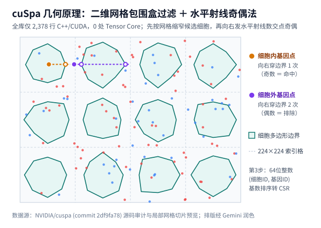

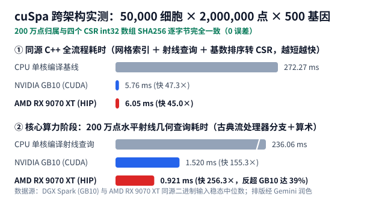

</details>

<details>
<summary>2. 非键力场：空间邻格与势能 / 32K及128K原子基准</summary>

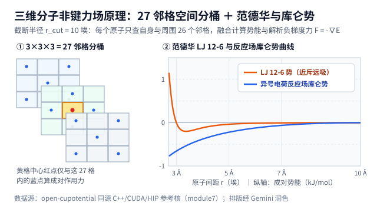

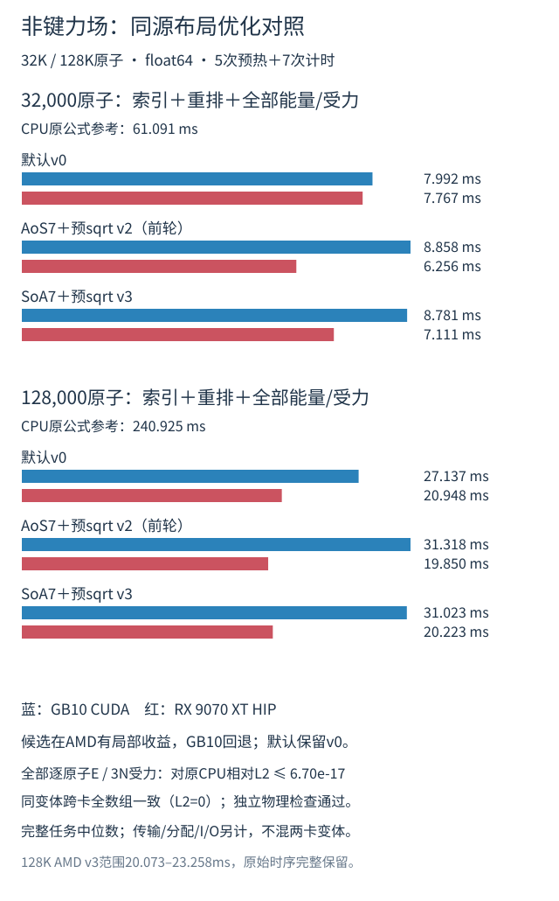

</details>

<details>
<summary>3. PME＋轨迹：能量守恒 / 1,000步NVE与NVT基准</summary>

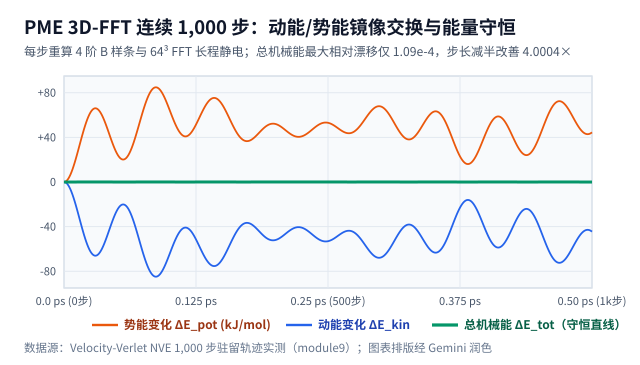

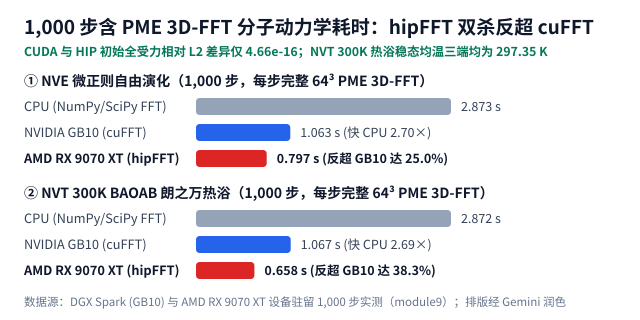

</details>

<details>
<summary>4. 万构象松弛：能量与碰撞 / 最新热态基准</summary>

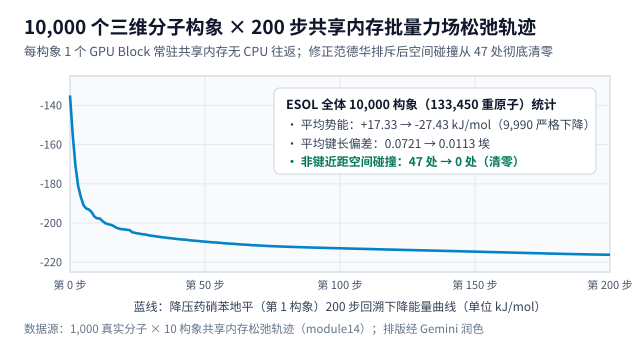

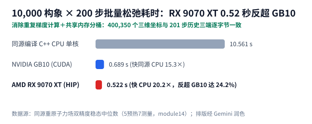

</details>

<details>
<summary>5. 驻留Davidson：本征值收敛 / 顺序与批处理基准</summary>

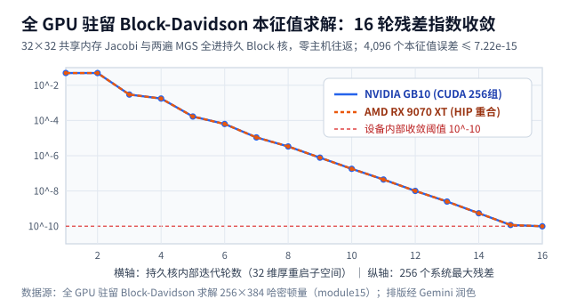

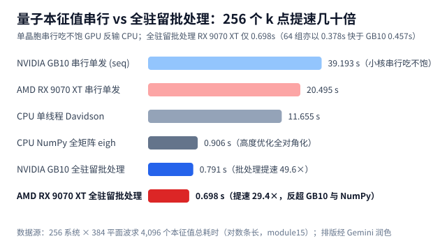

</details>

<details>
<summary>6. 射电FX：合成光子环重建 / 最新F与X分账基准</summary>

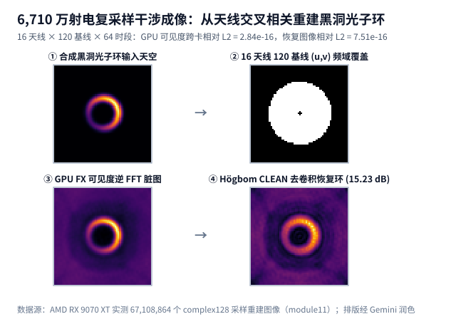

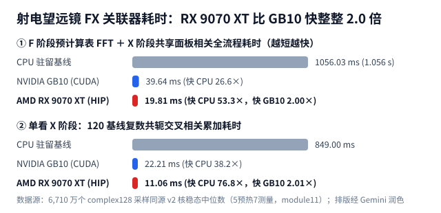

</details>

<details>
<summary>7. Profile-HMM：植入与背景分数 / 十万序列扫描基准</summary>

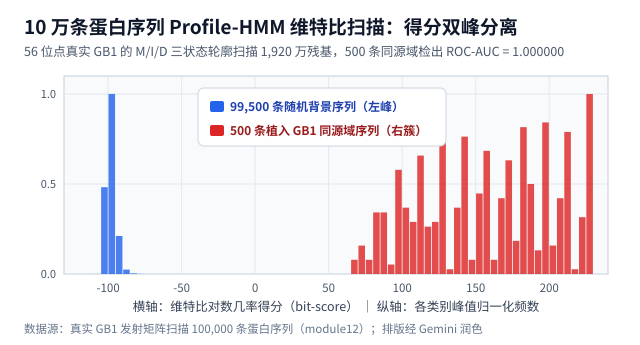

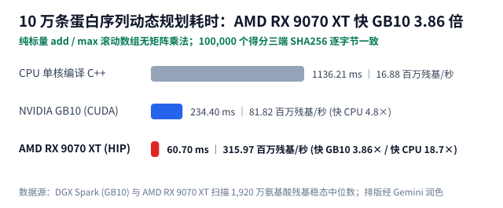

</details>

<details>
<summary>完整Uni-Mol：112个测试预测 / 15层中间误差</summary>

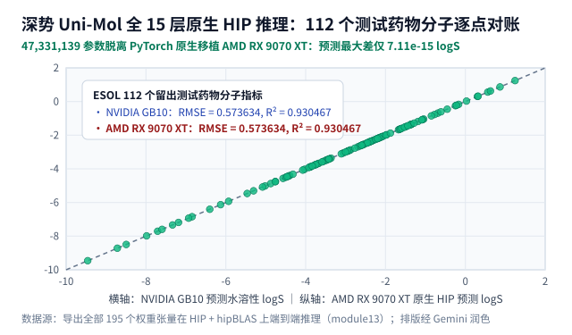

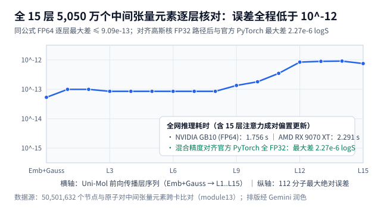

</details>

## 快速复现

使用已配置的 `.venv`，本地版本记录见 [`environment_freeze.txt`](results/environment_freeze.txt)。CUDA使用`nvcc`，Windows HIP构建脚本在各算子目录；路径与完整命令见[报告](REPORT.md)。

先核验已有完整输出与优化账本：

```bash
.venv/bin/python verify_optimized_modules.py
.venv/bin/python verify_phase3.py
```

核验器会读取本地原始数组；首次使用时按需执行对应实验，重建权重、构象与大规模二进制输入。轻量JSON和图表保存在仓库，完整重数据由脚本生成。

```bash
# 默认仅执行 phase 1：RDKit + Uni-Mol ESOL + cuSpa
.venv/bin/python run_pipeline.py

# phase 2：BBBP + 非键力场 + ESM-2
.venv/bin/python run_pipeline.py --phase 2

# phase 3：PME + 混合Davidson + FX + Profile-HMM + 完整Uni-Mol
.venv/bin/python run_pipeline.py --phase 3

# 最终驻留Davidson与构象热态基准，可单独执行
.venv/bin/python run_pipeline.py --modules resident_davidson
.venv/bin/python guard_process.py -- .venv/bin/python benchmark_conformer_optimized.py
```

`--reuse-results`用于显式复用已有结果；`--modules`可选择单项。Phase 4还包含文章审稿对象的哈希核验，按其记录对应的文章版本单独执行。所有重实验由 [`guard_process.py`](guard_process.py) 以250ms间隔监控统一内存，低于20GiB可用内存时停止该实验进程。

实验设计与逐项说明：[初始设计](EXPERIMENT_PLAN.md) · [Phase 2](PHASE2_FULL_AI4S_PLAN.md) · [Phase 3](PHASE3_GRAND_SLAM_AMD_PLAN.md) · [Phase 4](PHASE4_NVMOLKIT_AND_AUDIT_PLAN.md) · [报告](REPORT.md) · [DevHistory](DevHistory.md)。
