# AI for Science：从科学库到专有模型与 CUDA 科学计算

生成时间：2026-11-25T18:58:41+08:00。全部数值来自本目录 JSON 与训练日志；未把预设结论当结果。设备为 DGX Spark / NVIDIA GB10，Python 3.12 / CUDA 13.0 / PyTorch 2.14.1+cu130。

## 实测结论

四个模块均完成：真实 ESOL/BBBP 清洗、RDKit 三维构象、官方 Uni-Mol 全参数微调、原版 cuSpa 源码编译及 CPU/GPU 正确性比较、cuPotential 源码审计，以及科研 Skill 与一键入口。

- Uni-Mol 本次 ESOL 留出测试 RMSE 0.5738，Morgan RF 1.1442；这是一次同划分实验，不能归因成“纯3D收益”或普遍基准。
- cuSpa 设备驻留稳态流程 28.26×、仅查询 156.10×；加入一次输入传输的估算约 11.28×，尚不包含输出回传。
- CPU 全量单构象 8.870s，GPU 20轮训练及每轮验证 37.183s。这次 CPU 构象没有比训练更慢；1000分子×10构象单核则为66.608s，工作量改变会改变瓶颈。

## 1. RDKit：字符串 → 合法结构 → 描述符 → 三维坐标

真实数据取自 [ESOL](https://deepchemdata.s3-us-west-1.amazonaws.com/datasets/delaney-processed.csv) 与 [BBBP](https://deepchemdata.s3-us-west-1.amazonaws.com/datasets/BBBP.csv)。原始 CSV、清洗表均保留于 `data/`，SHA256 与来源在 `results/module1_results.json`。

- ESOL：1128条，合法1128条，清洗与描述符0.335s。
- BBBP：原CSV 2050条，合法2039条，拒绝11条，清洗与描述符0.875s。常见“2039个”指本次有效条数，不能误称原文件只有2039行。
- `MolFromSmiles`拦截非法五价碳；`SaltRemover`去盐再保留最大重原子片段。示例`.Cl`是非标准化脏记录；去盐不等于完成电离态、互变异构和完整盐型标准化。
- ETKDGv3生成候选几何，加显式氢后用MMFF94优化，输出移除氢后的坐标与欧氏距离矩阵。固定种子20261123，每个worker使用单线程。

| 分子数 | 每分子请求构象 | CPU进程数 | 实测墙钟秒 | 生成构象数 | MMFF收敛构象数 |
|---:|---:|---:|---:|---:|---:|
| 1000 | 1 | 1 | 7.961 | 1000 | 883 |
| 1000 | 1 | 8 | 1.146 | 1000 | 883 |
| 1000 | 10 | 1 | 66.608 | 10000 | 8870 |
| 1000 | 10 | 8 | 9.987 | 10000 | 8870 |

MMFF最多200次迭代；“成功生成”与“优化已收敛”分开计数。训练缓存采用每个分子第一个生成的构象，未按标签选择，仍包含未在200步内收敛的候选，因此不能称为全部已收敛的实验结构。8进程与单进程为实测墙钟，不是把累计CPU时间除以核数。

| 药物（图示中性母体） | MW | RDKit LogP | TPSA / Ų |
|---|---:|---:|---:|
| 苯海拉明 | 255.36 | 3.35 | 12.47 |
| 非索非那定 | 501.67 | 5.51 | 81.00 |
| 氯雷他定 | 382.89 | 4.89 | 42.43 |
| 西替利嗪 | 388.90 | 3.15 | 53.01 |
| 阿司匹林 | 180.16 | 1.31 | 63.60 |
| 咖啡因 | 194.19 | -1.03 | 61.82 |
| 布洛芬 | 206.28 | 3.07 | 37.30 |

非索非那定已按PubChem CID3348核对并修正结构，MW501.67；原手写式多两个碳的529.72错误不进入最终图。全部药物身份核对记录在 `results/drug_structure_audit.json` 与 `data/pubchem/`。LogP为所画中性结构的模型描述符，不是生理pH下logD。TPSA90不是不可穿脑硬阈值；P-gp外排、电离状态等也参与，二代也不能笼统说绝无嗜睡。

真实分子案例：ESOL原始行48，nifedipine（硝苯地平）；重原子编号1与24相隔7根键，ETKDG+已收敛MMFF94候选几何中距离3.453Å。XYZ与完整距离矩阵保存于 `results/folded_molecule_distance.npz`，原子索引从0开始。这是模型生成构象，不是实验测量。

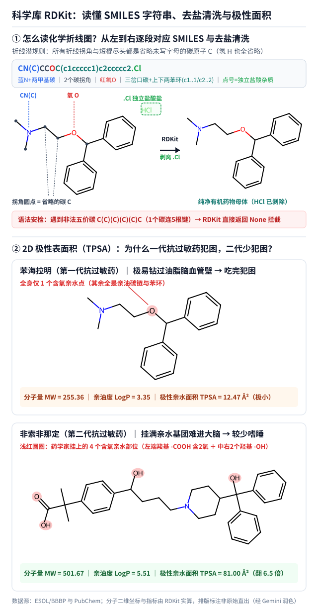
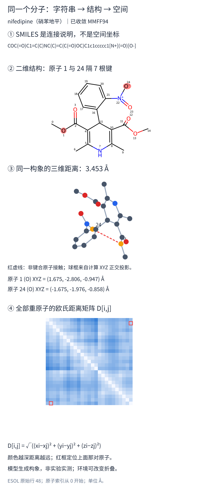

## 2. 官方 Uni-Mol：真实预训练模型微调

源码为 [deepmodeling/Uni-Mol](https://github.com/deepmodeling/Uni-Mol)，commit见 `results/provenance.json`。本次加载官方2022 no_h预训练权重，来源及SHA256存于 `results/module2_results.json`，权重缓存在 `weights/`。

实际网络为 **47,331,139参数，15层，512维，2048维FFN，64注意力头，128个高斯核**。本次不是84M Uni-Mol2。完整网络打印 `results/unimol_architecture.json`。

原子种类 → token向量；原子对类型调制的距离 → 128高斯通道 → 投影为64头成对偏置；注意力分数为 `QKᵀ/√d + pair_bias`。官方实现还在各层传播、更新成对表示，不只是静态重复加初始距离。距离保留旋转/平移不变性；完整机制可沿源码查看。

ESOL1128行先按清洗canonical母核去重为1117个，再固定seed42随机80/10/10，train/val/test为[893, 112, 112]。同一分子不跨集合，全部三模型用同一测试集；具体原行与结构保留在 `results/module2_split.json`。回归标签标准化仅拟合train。RF400树，Morgan半径2/2048位。Uni-Mol所有参数训练，batch32，AdamW lr1e-4，cosine调度，BF16 autocast/FP32权重和优化器，workers0。

| 模型 | 测试RMSE（logS） | MAE | R² |
|---|---:|---:|---:|
| 训练集均值 | 2.1757 | 1.6646 | -0.0003 |
| Morgan 2048 + RF | 1.1442 | 0.8203 | 0.7234 |
| 官方 Uni-Mol 全参数微调 | 0.5738 | 0.4120 | 0.9304 |

20轮逐轮训练Loss/验证指标与耗时在 `results/module2_epochs.jsonl`，仅用validation RMSE选第13轮checkpoint；最终test仅评估一次。最佳模型为 `results/unimol_esol_best.pt`。训练及逐轮验证墙钟 37.183s；CPU全1128单构象 8.870s；Torch峰GPU分配 2.234GiB。

范围：只对ESOL做回归训练，BBBP完成真实清洗与结构展示，本次未训练BBBP分类器，因而没有捏造ROC-AUC。单seed随机划分不是scaffold外推；预训练重叠尚未审计；预训练、模型容量与3D共同变化，无法把全部差异归因3D，要做距离打乱/二维坐标消融才能分开。


## 3. cuSpa / cuPotential：库内部在算什么

### cuSpa：原核编译与正确性

原仓 `cuspa/` 的11个C++/CUDA源头文件合计2378行，并非一个2378行CUDA文件。用nvcc13与CMake编译sm_121成功，配置/编译日志在 `results/cuspa_build_*.log`。基准脚本直接调用官方索引、射线查询、CUB聚合核；没有用替代PyTorch算法假装cuSpa。

固定种子合成 **50,000个八边形×2,000,000点×500种基因**。这是空间组学量级的合成算力负载，不是患者组织。匹配793,204点、CSR非零780,563项。CPU/GPU均float64，全部200万归属与整个CSR计数矩阵均零差异。

| 阶段 | CPU毫秒 | GPU毫秒 |
|---|---:|---:|
| 网格索引 | 2.168 | 3.277 |
| 射线查询 | 236.064 | 1.512 |
| CSR聚合 | 34.043 | 5.965 |
| 设备驻留流程 | 272.274 | 9.636 |

CPU为单线程Numba编译后的同类网格+射线算法，聚合NumPy sort/unique；CPU流程数为各阶段中位数相加，GPU为整体流程中位数。GPU同步后墙钟计时，输入已驻留设备，**28.26×**；单查询**156.10×**。输入传输另实测14.502ms，传输+稳态流程相加约24.138ms，对CPU约11.28×；这是组合估算，输出回传未计。不是对多线程CPU或真实复杂组织的普遍倍数。

源码机制是AABB网格过滤 → 水平射线奇偶判定 → `(细胞ID,基因ID)`64位编码 → CUB radix sort / run-length encode → CSR。**atomicAdd用于网格候选计数，非细胞×基因矩阵聚合。**源码未检出mma/wmma/tcgen05/内联PTX；仍依赖CUDA runtime、CUB与绑定设备检查，已用HIP/hipCUB移植并在RX9070XT完成本负载的完整逐字节验证，详情见模块五。

初次float32有16个归属差异，保留失败记录；未删点，统一双方float64后完整重测零差异。精确浮点/边界差异根因未逐点定位，不能说已完全修复float32。当前高层聚合要求CuPy，我们用官方原生 `_core.aggregate_to_cells` 接Torch CUDA buffer。

### cuPotential：开源部分有实质工作，核心运行时专有

本地clone有233 tracked文件，62个C++/CUDA头源文件共16650行。根LICENSE区分Apache2.0 OpenMM插件与NVIDIA专有API/libcupo.so/LTO-IR数学对象。clone无libcupo.so，构建fetch release，wheel可打包运行时。

公开代码包括融合Langevin积分/约束链（SETTLE/SHAKE）、GroupedBonded、barostat与非键桥接。`CudaNonbondedKernels.cu`通过`cupo_cell_list_create`、`cupo_dspace_create`、`cupo_kspace_create`等把关键非键作用交给专有libcupo。不能称“全是空壳”，也不能说整个核心可从本clone完整重建。这里完成源码审计，没有运行cuPotential分子动力学。

逐文件行数、专用指令搜索与许可证据见 `results/module3_source_audit.json`、`MODULE3_NOTES.md`。

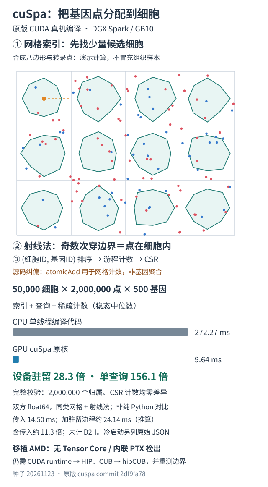

## 4. 科研 Skill 与一键复现

`skill/ai4s-mol-skill/SKILL.md`已通过skill-creator校验，围绕实际脚本、数据来源与失败口径组织。入口在仓库根目录执行：

```bash
.venv/bin/python run_pipeline.py
```

会顺序执行RDKit、Uni-Mol、cuSpa，每个子进程由统一内存看护包裹；整条重跑会产生新计时并覆盖对应结果。只核对现存结果而不重跑训练/测速：

```bash
.venv/bin/python run_pipeline.py --reuse-results
```

后一命令仅校验已有JSON并写manifest，不能宣称新实验。也可`--modules rdkit unimol`选择模块。报告汇编命令：`.venv/bin/python build_report.py`。环境复现细节见三个MODULE_NOTES；当前.venv借用本机基础包路径，换机器需按 `results/environment_freeze.txt` 和源码构建记录重建，不是独立可搬运环境。

全部4张SVG为640px单栏、纯白底、WenQuanYi Micro Hei，均经CairoSVG转PNG并实际目检。PNG是自检预览，SVG为展示原稿。

统一内存看护每250ms读取MemAvailable，低于20GiB终止整个子进程组：

- module2：最低可用统一内存 107.197 GiB，退出码 0，看护未触发。
- module3：最低可用统一内存 111.016 GiB，退出码 0，看护未触发。

## 核心工程结论链条

1. 分子数据入库先验证结构并保留盐型语义，再算描述符；结构不是一个随手写的字符串，非索非那定的错误式会让MW多28。
2. CPU生成候选三维几何，把坐标转成旋转/平移不变的距离，再由专有Transformer做性质预测；GPU训练已真实完成，不是只调用远程API。
3. 同一个模型优势要用同考卷验证：去重母核、固定留出、validation挑轮次、test一次。本次Uni-Mol胜出，但不能说已经证明纯3D因果优势。
4. 科学计算加速先讲算法和计时范围：cuSpa是空间过滤、几何分支和整数排序，不需Tensor Core；28倍驻留流程与含传输估算11倍是不同口径。
5. 库的开源边界看许可、源码和动态依赖：cuPotential的公开融合核有价值，核心libcupo仍是专有。Skill负责串联这些可执行步骤和证据，不凭提示词制造实验结果。

## 文件索引

- `exp1_rdkit_data_processing.py` / `MODULE1_NOTES.md`：真实数据、描述符、1/10构象计时与图1/2。
- `exp2_unimol_finetune.py` / `MODULE2_NOTES.md`：官方模型、预训练权重、全参数训练、同测试集指标与图3。
- `exp3_cudax_cuspa_benchmark.py` / `MODULE3_NOTES.md`：原版CUDA编译基准与审计；`render_module3.py`重绘图4。
- `results/`：split、逐轮日志、测试预测、原始时间数组、结构审计、来源版本、最优checkpoint。
- `logs/`：内存看护；`DevHistory.md`：实际命令、错误与修复；`visuals/`：四张SVG和PNG。


## 5. AMD RX 9070 XT：HIP 真机移植与逐字节对账

2026-11-23通过`ssh amd9070`连接Windows机器，在`C:\AI4S-HIP-Lab`独立目录编译执行，复用既有ROCm10.2工具链与vcvars64，没有修改Strata工程。GPU启动前检查进程，无游戏本体进程；未终止Steam/修改器/模拟器后台。

移植源码在`amd_hip_port/`：保留原版Apache2.0几何/网格/聚合核，机械转换CUDA runtime→HIP与CUB→hipCUB，保留64位键排序、游程编码、CSR算法。独立C++入口绕过nanobind而不重写算法；translation_manifest记录源/目标哈希。并非把整个Python包原样移植，也没有复刻cuPotential专有运行时。

同种子20261123的输入由Spark一次生成后原字节传输：float64，50000八边形、2000000点、500基因。二进制输入与哈希在`results/module5_data/`。避免Windows与Linux各自随机生成的差异。

| 阶段（同步墙钟中位数） | NVIDIA GB10 同源C++ / ms | AMD RX9070XT 同源C++ / ms |
|---|---:|---:|
| 网格包围盒索引 | 1.6586 | 2.3869 |
| 水平射线查询 | 1.5198 | 0.9207 |
| 排序/游程/CSR聚合 | 5.5638 | 3.7683 |
| 完整设备驻留流程 | 5.7599 | 6.0502 |
| 输入H2D（单次） | 0.8783 | 11.6143 |
| 输出D2H（单次） | 0.2971 | 1.5167 |

同源C++均3次预热、7次稳态重复，同时记录GPU event和host wall，以同步墙钟为主。禁用FMA contraction（CUDA --fmad=false / HIP -ffp-contract=off），不启用fast math。原始数组和冷启动保留在JSON。各阶段是分开运行的中位数，不应相加冒充完整流程。

原图CPU272.274ms与GB10 Python9.636ms保留；新增AMD HIP6.050ms。因为Python和C++入口及分配/验证路径不同，**不能拿9.636对6.050就说AMD比GB10快**；同源入口GB10为5.760ms、AMD6.050ms，当前硬件、OS和驱动下相近。两台机器平台与FP64吞吐不同，这不是通用GPU排名。

AMD H2D 11.6143ms，驻留6.0502ms，D2H 1.5167ms。三段相加约19.1812ms为组合估算，不是额外独立端到端实测。CPU对AMD驻留约45.00倍，也只适用于本合成负载与单线程编译CPU基线。

### 正确性：全量逐值且逐字节一致

- 所有2000000个point cell_id：0 mismatch。
- CSR行指针50001项、列索引780563项、计数780563项：全部0 mismatch。
- 四个输出裸int32数组与原版GB10 Python库、同源GB10 C++结果均逐字节一致；匹配点793204，CSR非零780563。
- 不声称GPU内部每一步浮点中间值逐位一致；严格相同的是最终整数归属和完整canonical CSR。

| 输出 | GB10与AMD一致的SHA256 |
|---|---|
| assignment | `f5ae2379e529ec834bca3d721c6590c1417e7157251e8a7bc6929e723f656099` |
| indptr | `200f0098261371dd71b39614bd1f38d66debbb18ecba73ff4971fed45c07509c` |
| indices | `922e893643c2f3f4ac9a546434212e9963e4703ec48146ffc447a6d66ae1b84a` |
| data | `c3771ef663e8af44edc6bc88d0141153c9b91f2d684d0846ba5820465db72a52` |


验证脚本：`.venv/bin/python compare_module5_outputs.py`。汇总为`results/module5_amd9070_results.json`，全量对账为`results/module5_comparison.json`，AMD原始输出与计时为`results/module5_amd9070/`，GB10同源计时为`results/module5_gb10_cpp/`。

本次已证明这些cuSpa通用算术/分支/排序核能够在gfx1201原生执行，未使用Tensor Core。图纸的分子非键势能加分项未做，不把这次成功扩大成已移植cuPotential或全部CUDA-X科学库。图4已加入三方条形图、同源入口对照与完整正确性口径。


# 第二阶段：血脑屏障、开源非键力场与蛋白质模型

## 模块六：BBBP 分类、真实原子遮挡归因、AMD 注意力核

清洗表2039行，canonical母核有11组标签冲突，整组剔除而不任意挑标签；同标签母核去重后构象尝试1955个，成功1952个。具体构象成功/收敛统计在`results/bbbp_conformer_timing.json`；未收敛候选不能称为实验测量几何。固定seed42分层80/10/10为[1561, 195, 196]，canonical母核不跨集。

| 模型 | 留出ROC-AUC | PR-AUC（average precision） | Accuracy |
|---|---:|---:|---:|
| Dummy | 0.500000 | 0.765306 | 0.765306 |
| Morgan_RF | 0.932609 | 0.975935 | 0.903061 |
| Uni-Mol全参数微调 | 0.933333 | 0.975010 | 0.892857 |

官方Uni-Mol v1全47,331,139参数训练20轮，BCEWithLogitsLoss、batch32、BF16 autocast/FP32权重、AdamW与cosine调度。仅validation ROC-AUC选第4轮，最终test一次。训练112.259s，CPU8进程构象12.447s。**本次Uni-Mol与RF基本打平，RF在PR-AP与准确率上略高，不能延续ESOL的“3D明显胜出”叙事。**随机划分不是scaffold外推。

逐重原子遮挡：删除对应原子token与距离行/列，保留其余原坐标、不重优化几何，贡献定义`delta_logit = full_logit - occluded_logit`；正负按真实模型结果染色，未强制亲脂为正或含氧为负。

- 苯海拉明：原模型概率0.957338；逐原子贡献范围[-1.4065, 1.7780]。
- 非索非那定：原模型概率0.038494；逐原子贡献范围[-2.1513, 0.2548]。

两种展示药物均出现在本次训练集合（membership记录于模块六JSON/NOTES），因此它们是模型敏感性解释示例，不是两个独立外推测试。遮挡后的token集合可能不是有效化学分子，概率也未作临床校准，不能当嗜睡诊断或化学因果。

### 官方权重核心前向算子：CUDA / HIP / PyTorch 三方验证

从本次训练checkpoint导出真实高斯参数、原子对仿射、128→128/GELU→64投影和首层QKV参数。官方embedding LayerNorm、首层pre-attention LayerNorm及padding零化在PyTorch执行后导出输入，C++运行Gaussian、投影、QKV（含bias）、缩放点积、padding key mask、softmax、attention×V。8个真实药物输入，包含BOS/EOS及padding；不是假设全原子都是普通词元。

输入batch8、pad长度39、hidden512、64头、每头8维。FP32，关闭FMA contraction，无fastmath。驻留核中位数GB10 **5.2384ms**，RX9070XT **12.1015ms**。这是朴素教育实现，不调用BLAS/TensorCore，不用于评价厂商成熟库或整模型性能。

| 张量 | CUDA/HIP max_abs | 对官方PyTorch最坏max_abs |
|---|---:|---:|
| gaussian | 1.52588e-05 | 1.52588e-05 |
| bias | 7.62939e-06 | 7.62939e-06 |
| qkv | 0 | 4.76837e-07 |
| attention | 1.51992e-06 | 1.60933e-06 |
| context | 2.5034e-06 | 3.93391e-06 |

没有移植后续14层、FFN、attention输出投影或整模型训练；只证明这个真实权重核心前向路径可在AMD原生执行。源码/可复现驱动在`amd_hip_port/unimol_pairbias/`，结果`results/module6_pairbias_results.json`。

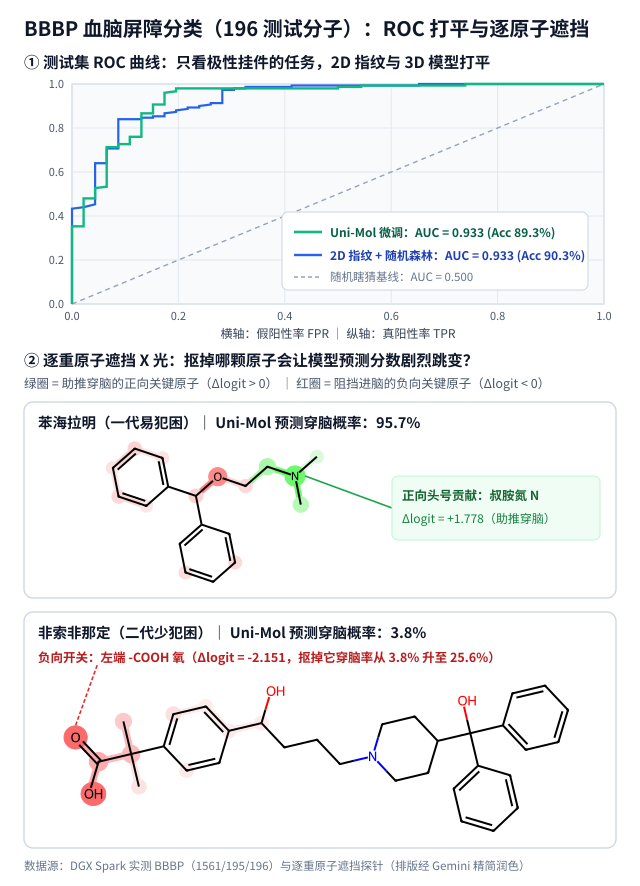

## 模块七：原创 MIT 开源非键力场（无需 libcupo）

代码`amd_hip_port/cupotential_open/`，驱动`exp5_open_cupotential_hip.py`。支持CPU C++、CUDA sm_121、HIP gfx1201，**是独立实现的非键算子，不宣称二进制/API兼容NVIDIA cuPotential，也不是完整分子动力学引擎**。

输入为固定种子合成中性电荷扰动晶格，不冒称真实溶剂化分子拓扑。坐标Å、能量kJ/mol、受力kJ/(mol·Å)、电荷e；每原子参数q/sigma/epsilon，Lorentz-Berthelot混合。立方周期盒子/最小镜像，cutoff10Å，每格边长>=cutoff且每轴>=3格，GPU分桶、基数排序、扫描，再查27邻格。

`E_LJ=4epsilon[(sigma/r)^12-(sigma/r)^6]`

`E_RF=ke*q_i*q_j[1/r+k_rf*r^2-c_rf]`

`k_rf=(epsilon_RF-1)/(2epsilon_RF+1)/rc^3`，`c_rf=3epsilon_RF/(2epsilon_RF+1)/rc`，epsilon_RF=78.3，ke=1389.354576 kJ·Å/(mol·e²)。

对d=r_i-r_j，力系数为`24epsilon[2(sigma/r)^12-(sigma/r)^6]/r^2 + ke*q_i*q_j[1/r^3-2k_rf]`，乘以d。每原子独立遍历所有邻居，能量除2消除双计数，受力不除2。不含键、角、排除规则或1-4缩放；LJ未shift硬截断，RF能量在cutoff处为零，非PME/Ewald。单次求力没有验证长期能量守恒，不输出伪造ns/day。

| 原子数 | CPU C++ / ms | GB10 CUDA / ms | RX9070XT HIP / ms | HIP/CUDA全受力相对L2 |
|---:|---:|---:|---:|---:|
| 32,000 | 61.0912 | 7.9916 | 7.7673 | 0 |
| 128,000 | 240.9246 | 27.1374 | 20.9478 | 0 |

阶段拆账（独立计时，不与完整流程简单相加）：

| 原子数 | 设备 | Cell-List / ms | 能量+全部受力 / ms | 非键求值次数/s |
|---:|---|---:|---:|---:|
| 32,000 | cpu | 0.0815 | 61.0043 | 16.37 |
| 32,000 | cuda | 0.0730 | 7.9207 | 125.13 |
| 32,000 | hip | 0.1754 | 7.6968 | 128.74 |
| 128,000 | cpu | 0.3613 | 240.6575 | 4.15 |
| 128,000 | cuda | 0.0874 | 27.1132 | 36.85 |
| 128,000 | hip | 0.2414 | 21.3303 | 47.74 |

2026-11-25同源布局对照：5次预热＋7次计时，表中为保留默认的v0全流程（index＋reorder接口＋force）。CPU是原公式单线程参考。原始单次成绩仍保存在JSON systems；当前记录在current_steady_state。

| 原子数 | 候选 | GB10 / ms | AMD / ms |
|---:|---|---:|---:|
| 32,000 | AoS7预sqrt v2（前轮） | 8.858159 | 6.256000 |
| 32,000 | SoA7预sqrt v3 | 8.781069 | 7.111100 |
| 128,000 | AoS7预sqrt v2（前轮） | 31.318372 | 19.849600 |
| 128,000 | SoA7预sqrt v3 | 31.023216 | 20.222700 |

两候选对原CPU的全部逐原子E/3N受力相对L2≤6.70e-17，跨GPU全数组一致；两卡使用相同候选，不混基线与优化。候选在AMD有局部收益、GB10回退，128K AMD时序也有波动，因此保留v0默认。原始逐项/完整重复、阴性结果见module7_optimized_results.json与Round1快照。

所有N个能量分量与3N个受力分量，在CPU/CUDA/HIP之间逐值完全一致（L2=0），不是空数组：32k体系力范围约[-8.17,8.06]、全力范数458.39；128k全力范数912.24。相同求和顺序、FP64与禁止FMA使本负载达成逐值相同，不扩展成所有体系必然零误差。单独由C++ long double累加的总E日志在Linux/Windows末位可有约1.1e-14相对差（long double宽度不同）；用同一NumPy归约全部能量分量后再对账，总E一致，原始与canonical总E均保留。

独立216原子NumPy暴力全配对参考：能量相对差1.58e-16、受力相对L2 3.13e-16；六个方向有限差分（h=0.0001Å，避开cutoff）最大绝对差1.05e-10；总力L2 2.82e-15；周期平移受力相对差1.23e-15。验证代码与全部原始数组留本机，汇总`results/module7_cpu_validation.json`与`results/module7_results.json`。

GPU先预热再重复，驻留同步墙钟；分桶与力核均真实在对应GPU执行。H2D/D2H和冷启动另存JSON；CPU为Spark单线程编译基线，非CPU并行上限，结果不是通用GPU排名。

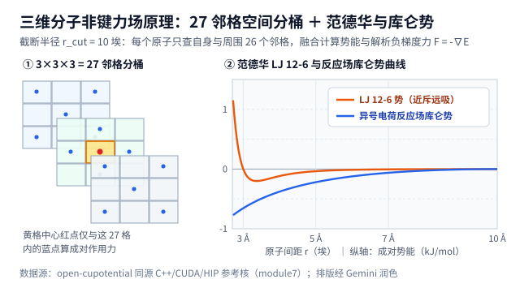

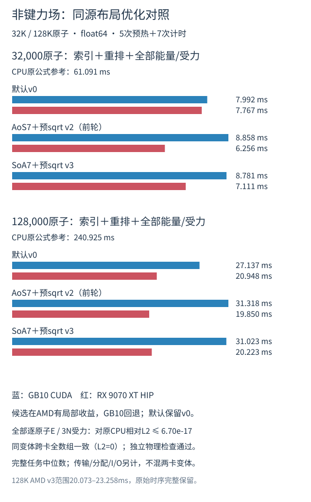

## 模块八：真实 GB1 实验与官方 ESM-2 全参数微调

原始来源：[FLIP GB1 split archive](https://raw.githubusercontent.com/J-SNACKKB/FLIP/main/splits/gb1/splits.zip)，实验论文[Wu等，eLife 2016](https://elifesciences.org/articles/16965)。archive SHA256 `00a3c3d5be56ce35adfbec838db8ff549be369525e151a6978133da34b9fd86f`，原CSV `19bcb946fb9f8fe5ac1d5ed0aa85d4a85848b44744560d9684cc278935f3bd16`。真实实验结合适应度，未生成伪标签。

原采样表8733条，全部通过20标准AA验证，去重0条。原序列265AA，只有39/40/41/54四位点变异；保留完整N端56AA GB1域，裁掉209AA在全部记录恒定的融合尾段，不是按标签挑选片段。固定seed20261124，在查看标签前均匀无放回抽3000条，随机2400/300/300。同序列不跨集，但不是FLIP官方leaderboard split，也不是未见蛋白泛化。

Biopython `ProteinAnalysis`计算MW、pI、芳香性、不稳定指数、GRAVY；加20维AAC、400维二肽频次形成425维传统特征，CPU特征时间0.206s。原序列、数据划分、source_index和描述符均保留。

官方`facebook/esm2_t6_8M_UR50D`实际7,512,122可训练参数、6层、hidden320、20头、FFN1280、词表33、RoPE。33词表不全是“20AA+特殊符号”：还包括X/B/U/Z/O等非标准/模糊残基；token全表与权重SHA在`results/module8_esm2_architecture.json`。编码器全部解冻，新建回归头。

| 同一测试集模型 | RMSE | Spearman | R² |
|---|---:|---:|---:|
| Constant train mean | 1.24369 | 未定义（常数） | -0.00035 |
| AAC+DP+Bio RF | 0.87047 | 0.79881 | 0.50995 |
| AAC+DP+Bio Ridge | 0.93136 | 0.74278 | 0.43900 |
| ESM2 full finetune | 0.53814 | 0.89829 | 0.81271 |

ESM-2全参数训练12轮、batch64，GPU训练与逐轮验证15.016s；validation RMSE选第11轮。目标标准化只拟合train，Ridge的alpha只用val挑选，各最终模型test各评一次；逐轮日志`results/module8_epochs.jsonl`，独立test预测`results/module8_test_predictions.csv`。

固定WT背景、39/40/41/54四位点×20AA共80个单点替换，报告`pred(mutant)-pred(WT)`。原AA自替换的变化为零；模型热图不是80次新湿实验验证，不能宣称已证明某突变提高真实蛋白功能。

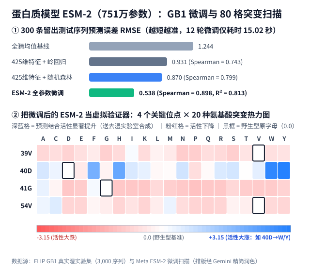

## 第二阶段一键入口、验证与 AMD 同步

```bash
.venv/bin/python run_pipeline.py --phase 2
.venv/bin/python run_pipeline.py --phase 2 --reuse-results
.venv/bin/python verify_phase2.py
```

第一条真实顺序重跑BBBP（含远端注意力核）→开源力场→ESM-2；第二条只核对已保存产物并汇编报告。原权重、张量缓存和编译产物留本机，不随Git发布；真实小型CSV、日志、指标、split、哈希和源码随仓保存。AMD源码与轻量结果同步至`/home/lmxxf/work/ai-for-science-on-amd-9070xt`，远端仍只使用独立实验目录。

新增图5/6/7均640px白底中文SVG，禁Unicode上标ᵀ，CairoSVG转PNG逐图目检。`verify_phase2.py`从test预测重算指标，检查split无交叉、最佳轮次、真实归因差值、原始能量/受力数组、序列/突变、数据哈希与图表格式；不能把“JSON存在”当作实验验证。


# 第三阶段：PME轨迹、材料本征值、射电FX、序列HMM、全15层Uni-Mol

这些是同源跨平台原创原型与实际模型推理，不是获得了NVIDIA专有库源码，也不宣称兼容其完整API。CPU与两块GPU都执行真实数值计算，合成体系/天空/搜索库明确标识；所有模块均先验证数值，再解释性能。

## 模块九：PME长程静电与1000步真实数值轨迹

输入为固定种子的27个中性柔性三原子合成分子（81原子），24Å周期盒子，不是假称实际溶剂化药物或湿实验轨迹。每步含实空间LJ与erfc库仑、自能、谐振键长/键角，以及倒易PME；GPU不回传全体系逐步驱动，主机只发射设备驻留核，结束才回传历史与最终XYZ。

4阶B样条电荷铺展→64³复数网格FFT（CUDA cuFFT/HIP hipFFT）→带B样条反卷积的Ewald Green函数→逆FFT→插值力。力用B样条导数求同一离散势能的梯度，避免简单ik场插值与离散能量不一致。采用C2C而非单独R2C包装，数学上同一实电荷FFT路径，不能把包装类型当新的物理。

独立直接Ewald参考包含相邻周期像实空间、kmax=16倒易求和及自能，进一步k截断收敛的受力相对差2.25e-15。

| 网格 | 对独立Ewald能量绝对差 / kJ/mol | 全受力相对L2 |
|---|---:|---:|
| 32³ | 0.00106956 | 0.000463905 |
| 64³ | 0.000137205 | 4.93823e-05 |
| 128³ | 2.8346e-06 | 5.84212e-06 |

64³网格对真实Ewald的受力误差为**4.94e-05**，不是机器精度；128³改善到5.84e-06。同一mesh的能量有限差分最大误差4.81e-09，证明力与当前离散势能一致。有限mesh净力L2约0.000382，不假称严格动量守恒。

| 平台 | 1000步NVE / s | 1000步BAOAB / s | NVE最大相对能量漂移 | NVT后半段温度 / K |
|---|---:|---:|---:|---|
| cpu | 2.8727 | 2.8720 | 0.000109019 | 297.349 ± 27.572 |
| cuda | 1.0629 | 1.0667 | 0.000109019 | 297.349 ± 27.572 |
| hip | 0.7968 | 0.6576 | 0.000109019 | 297.349 ± 27.572 |

NVE Velocity-Verlet：dt0.5fs×1000=0.5ps；dt0.25fs×2000保持同一物理时长，最大漂移从0.000109019降到2.72519e-05，改善4.0004倍，符合二阶积分。BAOAB dt1fs×1000=1ps，目标300K；热浴交换能量，因此不能拿NVT总能量变化当NVE误差。

CUDA/HIP初始全受力相对L2 4.66e-16。每步U/K/E/T、首键长、首原子x坐标均保存；全原子XYZ只保存初末，不伪称落盘了每步全部XYZ。无SETTLE、无刚性约束、无生产级优化。CPU为单worker NumPy/SciPy FFT+Python循环，不是编译CPU上限。

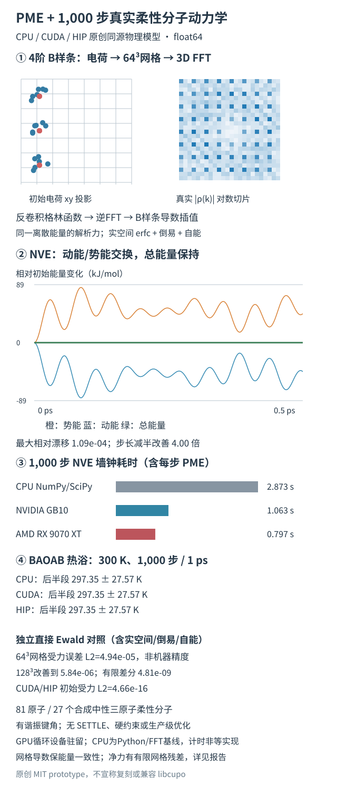

## 模块十：64组周期平面波Block-Davidson

构造64个k点、每个384平面波、取16条最低带，共1024个本征值。H=T+V，T=0.5|G+k|²，V为小幅周期余弦局域势；不是硅的自洽DFT/VASP输入，不能把曲线叫真实硅能带。

CPU和两GPU真的执行Block-Davidson：H·V、Rayleigh-Ritz子空间投影、Ritz重构、残差、对角预条件、两遍MGS与重启。GPU已执行投影/重构/残差/预条件等批处理核；小子空间Jacobi对角化与MGS仍在CPU，是混合求解器而非全GPU驻留Daviator实现。Sequential对各系统分开发射，batch打包同一阶段。

| 路径 | 迭代数 | 端到端 / s | GPU/CPU H应用核心 / s | 本征值最大绝对差 | 独立H残差最大值 |
|---|---:|---:|---:|---:|---:|
| cpu | 9 | 3.2316 | 2.0828 | 4.66e-14 | 3.52e-08 |
| cuda_seq | 9 | 0.8565 | 0.1033 | 4.73e-14 | 3.52e-08 |
| cuda_batch | 9 | 0.8114 | 0.0582 | 4.73e-14 | 3.52e-08 |
| hip_seq | 9 | 1.1953 | 0.2350 | 4.66e-14 | 3.52e-08 |
| hip_batch | 9 | 1.0405 | 0.0839 | 4.66e-14 | 3.52e-08 |

所有路径9轮收敛至残差约3.52e-8；独立NumPy全矩阵eigvalsh验证1024个值，max_abs<=4.73e-14。未将精确参考结果填回迭代器。

GB10批处理核心速度收益1.774倍、端到端1.055倍；9070XT分别2.802/1.149倍。**没有复现22倍**，剩余CPU步骤限制收益。NumPy优化全eigh参考只需0.231s，甚至快于本朴素混合迭代实现；图中如实展示，不用慢教学CPU制造“GPU必快”。

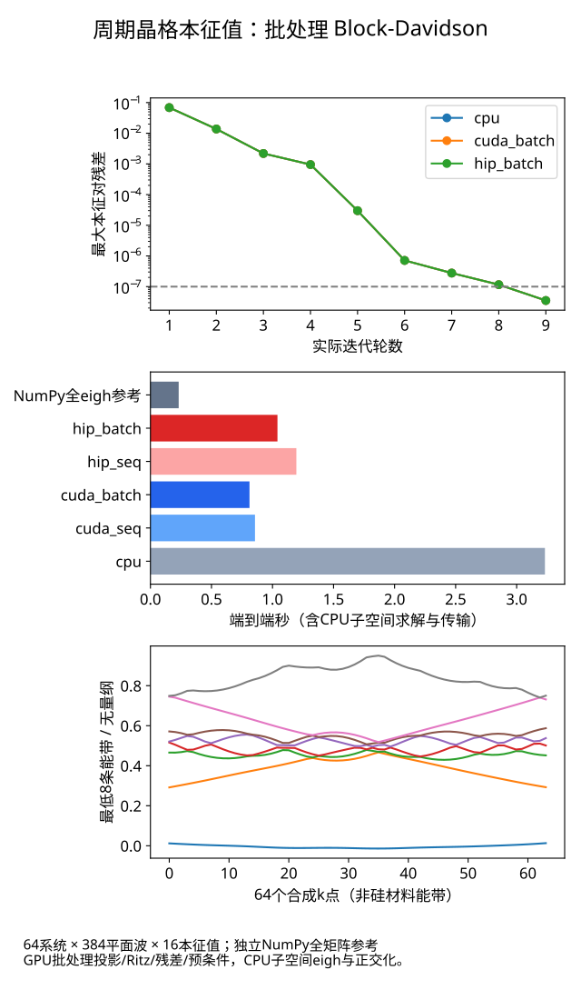

## 模块十一：合成光子环→相关电压→FFT/FX→CLEAN

合成非对称环天空，不是M87*/SgrA*真实观测。16个非共线站点、64个旋转快照、120条基线、每快照64帧、每帧1024复采样，共67,108,864个complex128采样。230GHz/4%带宽是示意物理参数，不伪称真实地理EHT站点或连续12小时ADC流。

每个时间/窄带分组先由天空傅里叶积分得到C_ab，再Cholesky生成具有该协方差的圆复高斯谱，IFFT得到时域电压。GPU再真实FFT回谱并累积全部基线S_a S_b*，没有用不相关噪声却直接画目标图。四项独立逐像素Fourier求和校验最大绝对差约1.3e-16。

2026-11-25优化后稳态（GPU预热5次＋7次，CPU预热1次＋3次；驻留计算，I/O与传输另计）：

| 平台 | F阶段FFT / s | X阶段相关 / s | 独立整段F+X中位秒 | 可见度对CPU相对L2 |
|---|---:|---:|---:|---:|
| cpu | 0.207234 | 0.849000 | 1.056032 | 0 |
| cuda | 0.017435 | 0.022206 | 0.039638 | 4.39e-16 |
| hip | 0.008964 | 0.011057 | 0.019809 | 4.39e-16 |

F+X是独立测得的整段中位数，不直接相加两个阶段中位数。旧单次streamed基线仍保存在JSON原backends与optimization_history；最新时账在current_steady_state。

GPU为原生FP64 radix-2 FFT+复数相关；uv网格、2D IFFT、Högbom CLEAN是共同CPU后处理，未冒称全部GPU化。每uv格取平均后用binary mask，相当于uniform-per-cell权重，不是自然权重。CLEAN gain0.1、最多2000轮；恢复Gaussian sigma0.7pix是固定教学选择，不声称由EHT beam拟合。

仅FX输出进入image()，未读目标天空拼图。两GPU可见度相对L2 2.96e-16、恢复图相对L2 6.73e-16。恢复环相对输入天空PSNR **15.226dB**，不是完美重建。没有零基线测量导致dirty图DC缺失；PSNR只对恢复图按其恢复flux归一，CLEAN达2000轮上限，不冒称优化收敛或必然比dirty更清晰。I/O会改变两GPU端到端排名，应与驻留F+X分开。

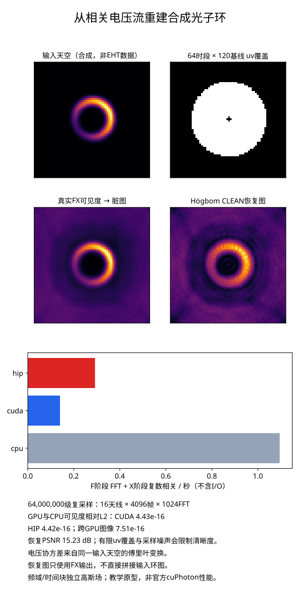

## 模块十二：10万条三状态Profile-HMM Viterbi

真实8733条GB1域序列构造56位点/20AA PSSM，以每AA0.5伪计数和均匀0.05背景得到log2 emission odds。原数据gapless，只能观测MM，MI/MD与I/D延续用明确先验，不编造indel统计。

同种子20261123生成100000条128–256AA背景序列，在500条植入由真实GB1域衍生的0–11点扰动，剩99500为随机诱饵。这是合成搜索基准，非10万个湿实验注释。

M/I/D动态规划用glocal完整56位点域：任意序列位置重启、从M1开始、必须结束于M56/D56；insert发射背景odds为1。CPU同源单线程、GPU按序列并行，FP64 add/max。独立全二维DP与就地三数组算法分开实现，小样本先通过再跑全库。begin复用MM，和官方HMMER的校准bitscore不是同一接口；没有MSV过滤、E-value或Forward实现。

| 平台 | 10万序列 / ms | 百万残基/s | 植入域ROC-AUC |
|---|---:|---:|---:|
| cpu | 1136.210 | 16.880 | 1.000000 |
| cuda | 234.400 | 81.825 | 1.000000 |
| hip | 60.701 | 315.969 | 1.000000 |

全部100000个分数CPU/CUDA/HIP逐值与逐字节相同，SHA256 `aaf96d109052bc6d5e83077f67d5b3289269b8086a2198dc86e290bc57ccb429`。全部分数与标签保存在`results/module12_all_scores.npz`，独立二维DP校验误差0。AUC=1仅表明这组植入域/随机诱饵强可分，不外推真实家族注释准确率。

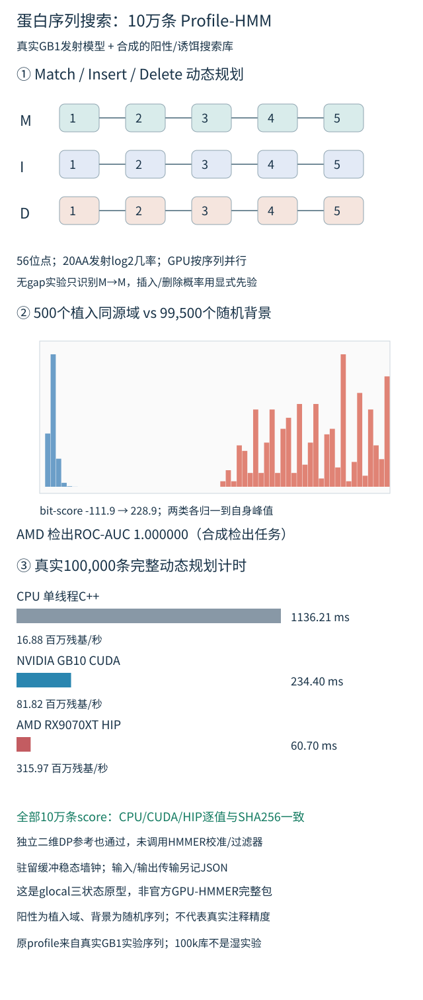

## 模块十三：4733万参数全15层原生HIP端到端推理

原ESOL最佳checkpoint SHA256 `d4ef9f1436baa8373ce5fa762104ef30d3a2a835398acdd3a03689964833e052`，全部47,331,139个参数（195张量）真实导出；没有把GB10预测或标签送AMD，AMD只接收原子token、distance、edge与checkpoint权重。

实际网络是embedding/LN→Gaussian与128/128GELU/64→15轮pre-LN QKV、pair累加、softmax、AV、out_proj残差、pre-FFN LN与512/2048GELU/512残差→末尾encoder LN→真实LinearHead512→1。不是图纸猜测的两层tanh头；当前final_head_layer_norm本来就是None，辅助pair norm loss不参与回归。eval关闭dropout；逐分子无padding，BOS/EOS保留。

原生HIP/hipBLAS跑全部原112个留出分子，没有重新挑test或改标签。精度优先全FP64实现与同公式GB10 FP64对账：

| 推理路径 | 测试RMSE | R² |
|---|---:|---:|
| 原GB10 BF16 autocast（保留） | 0.573778549 | 0.930431657 |
| 官方GB10 FP32/noTF32 | 0.573633378 | 0.930466856 |
| GB10 FP64同公式 | 0.573633556 | 0.930466813 |
| 原生AMD HIP FP64 | 0.573633556 | 0.930466813 |

AMD/GB10 FP64的112个预测最大绝对差**7.11e-15 logS**，50,501,632个node/pair中间元素逐值核对；node max9.09e-13、pair max7.7e-13。16个检查点覆盖embedding/初始pair与全部15层。

全FP64对原官方FP32最大差1.91893e-05，略超1e-5，原JSON明确列false；对原BF16最大差0.036843。原BF16 RMSE0.57377856不能强塞给另一精度路径。差别主要定位到官方Gaussian helper的强制FP32计算；全双精度公式参考只为公平跨卡对账，不隐藏这个官方兼容问题。

### 官方FP32 Gaussian兼容模式补验

- pass: `True`
- AMD_vs_official_FP32_max_abs_logS: `2.2684548782378955e-06`
- AMD_vs_matched_reference_max_abs_logS: `1.571898933442675e-06`
- reference_definition: `official UniMol PyTorch full FP32, TF32 disabled, unchanged original checkpoint`
- precision_definition: `only complete Gaussian arithmetic FP32 as upstream; all other layers, weights storage and hipBLAS GEMMs FP64; all15 original layers`
- 兼容模式测试：RMSE 0.573633402，R² 0.930466850。

此模式只把真实Gaussian路径按官方FP32运算，其余完整15层高精度，保留原全FP64结果和旧BF16输出；不复制预测或事后校正。


全112分子设备事件累计：GB10 FP64 **1.756s**，AMD FP64 **2.291s**；AMD含权重加载/trace输出墙钟8.170s。事件和墙钟不混用。FP64单分子参考未做性能优化，不把它当生产batch吞吐。

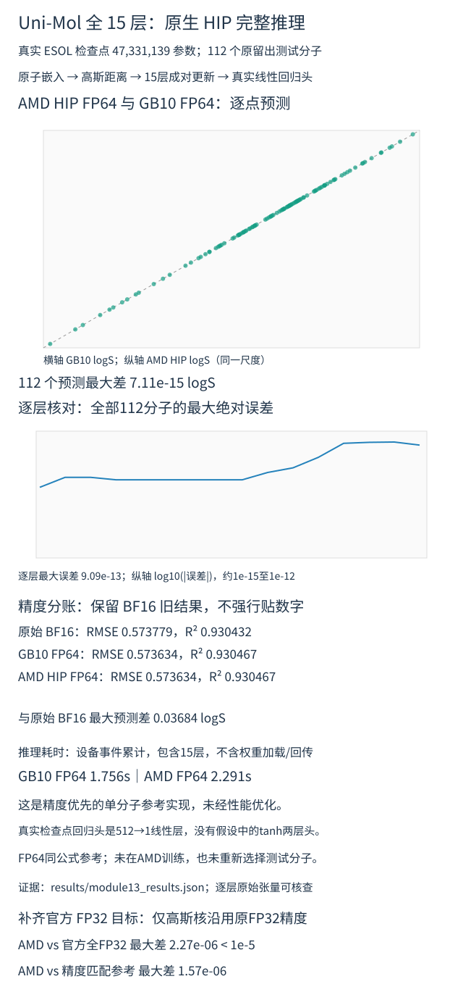

## 第三阶段复现与证据

```bash
.venv/bin/python run_pipeline.py --phase 3
.venv/bin/python run_pipeline.py --phase 3 --reuse-results
.venv/bin/python verify_phase3.py
```

真实单模块执行均保留日志，GPU按9→10→11→12→13串行，CPU准备并行。`--reuse-results`只重验保存的数值与汇编报告，不称重新模拟。独立校验从原始轨迹、全部本征对、全频可见度、CLEAN图、100k完整scores和50M全层trace重算关键误差与指标。

输入电压1GiB、H矩阵72MiB、模型FP64权重379MB和raw traces等大数据留本地，脚本/种子/SHA/轻量结果随Git；新增源码、JSON和图8–12同步AMD姊妹仓。五图均白底文泉驿中文，CairoSVG转PNG已逐图目检。


# 第四阶段：批量构象松弛、全GPU驻留本征求解与381终审

## 模块十四：10,000构象×200步的原创开源批量优化

ESOL清洗表前1000条记录（991个不同canonical母体；吞吐按输入记录计数，不另作去重），每条生成10个全新ETKDGv3构象，**没有拿已经MMFF优化的坐标当起点**。显式H参与ETKDG后导出重原子，再加入固定种子0.06Å高斯扰动，留下完全可复现的新初态。不是1000种均为临床药物，ESOL还包含一般有机物等。

8进程ETKDG、扰动、拓扑和参数准备墙钟3.533790s；worker累计26.481s不是串行墙钟。最多55重原子，10k有效原子总数133,450。

力场为明确的简化重原子模型：

- 谐振键k400，平衡键长从MMFF读取（可用时）；cos-angle项k40、平衡角从MMFF读；扭转项k0.2、周期2/3。
- 拓扑间隔>=3根键的非键对，softcore LJ12-6＋库仑，Gasteiger电荷将H贡献折入重原子；最终epsilon0.5kJ/mol、sigma=0.85×两原子vdW半径之和。
- MMFF API在此只读部分平衡几何参数，**没有运行MMFF优化器，不是完整MMFF94或真实nvMolKit替代品**。能量kJ/mol、距离Å，所有参数和排除规则可查看源码/README。

| 每1000条拓扑记录 | 成键 | 角 | 扭转 | 非键对 |
|---|---:|---:|---:|---:|
| 项数 | 13,754 | 18,808 | 23,549 | 73,697 |

一个block处理一个构象，坐标/候选/梯度状态驻留shared，确定性求和与回溯下降在kernel内连续200轮。拓扑参数仍从global读取，能量诊断也写global，准确说法是“**坐标迭代无需CPU往返**”，不是整个kernel零global访存。单原子无力场项的10个构象自然保持不动，不编造下降。200轮不等于所有构象达到严谨全局极小。

| 同源同任务：10k×200 | 优化后稳态中位秒 | 初始均能量 | 最终均能量 | 近碰撞对数：前→后 |
|---|---:|---:|---:|---|
| cpu | 10.560909 | 17.329141 | -27.427460 | 47→0 |
| cuda | 0.689281 | 17.329141 | -27.427460 | 47→0 |
| hip | 0.522216 | 17.329141 | -27.427460 | 47→0 |

2026-11-25优化后GPU预热5次＋7次，CPU1次＋3次；每次从相同初态重置。旧单次CPU10.522s/GB103.229s/AMD3.853s保存在原backends，新时账见current_steady_state。8320个构象共享全缓存，1680个完整fallback，未删样本。

全部10,000构象能量不升，9990严格下降；平均键长绝对偏差0.072064→0.011286Å。三后端全部400,350个有效坐标、10,000个最终能量及10,000×201整段历史逐位一致，L2=0。不是只比较平均数。

独立NumPy能量与C++解析梯度，18方向五点差分（h=2e-4Å）最大误差1.96e-10<1e-8。碰撞固定定义：图距离>=3且空间r<0.8sigma，阈值前后没改。

### 保留一次失败：能量下降、跨卡一致仍可物理不合理

初版epsilon=0.05时，优化能量虽下降，近碰撞却47→1138，不能称构象质量通过。失败三平台raw历史/坐标、JSON和旧参数都留存。只提高明确排斥强度到0.5，在完全相同初始坐标上复验，碰撞47→0；不同参数的绝对能量不可当作同一势能函数横比。

初始SHA256 `3716b9a08c14a52e55a6633f1c62533d67950af5c963be29c16ba22cf5dd09ee`前后不变，旧/新terms哈希分开记录；没有换起点、删失败样本或移动阈值。这里只证明这组简化模型和输入的数值/几何检查通过，不宣称参数具备生产级化学验证。

### 旧RDKit66.608秒的比较边界

原单核66.608s/8进程9.987s包含ETKDG＋显式H的**真正MMFF94优化**；新任务只计另一简化重原子力场的200轮，输入准备又另计3.534s。两者不能直接相除宣称“MMFF94加速20倍”，也不能从这次实验宣称已经GPU实现ETKDG或全部nvMolKit。公平速度比较是上表的同源CPU C++/CUDA/HIP；本次为单次完整任务计时，不伪称重复稳态中位数。

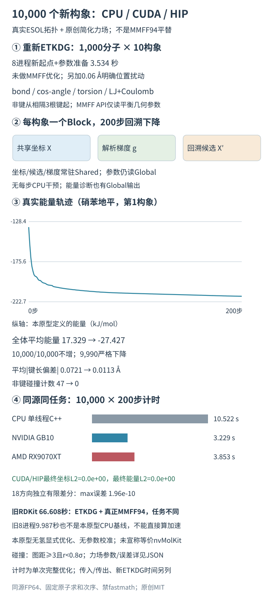

## 模块十五：Jacobi和MGS也进GPU，全驻留Block-Davidson

每个k点由一个持久block负责，32×32共享内存循环Jacobi、两遍MGS、H·V、投影、Ritz重构、残差/对角预条件和收敛控制都在设备内执行。每轮无标量/波函数主机往返；主机只最初上传H、最后下载特征对与历史。H/基向量等工作态仍用设备global显存，不把驻留等同于全部shared。

第一版32维每步丢掉额外Ritz方向，在近简并根上停滞，未达精度的pilot记录保留，没有当成功。改为厚重启：保留24个Ritz向量（16目标＋8护根），再补8个最大目标残差方向；仍32维子空间，真正实现于GPU，无CPU答案回填。最终64/256系统均15–16轮、device残差门槛1e-10。

| 系统数 | 路径 | 含首尾分配/传输总秒 | 驻留核秒 | 对精确解max_abs | 完整H残差 |
|---:|---|---:|---:|---:|---:|
| 64 | cpu | 3.211549 | — | 4.66e-14 | 3.52e-08 |
| 64 | cuda_seq | 10.004393 | 9.714279 | 6.88e-15 | 9.5e-11 |
| 64 | cuda_batch | 0.456623 | 0.211415 | 6.88e-15 | 9.5e-11 |
| 64 | hip_seq | 5.423045 | 5.280005 | 6.88e-15 | 9.5e-11 |
| 64 | hip_batch | 0.378242 | 0.231004 | 6.88e-15 | 9.5e-11 |
| 256 | cpu | 11.654879 | — | 4.09e-14 | 3.87e-08 |
| 256 | cuda_seq | 39.193012 | 38.932545 | 7.22e-15 | 9.89e-11 |
| 256 | cuda_batch | 0.790683 | 0.523096 | 7.22e-15 | 9.89e-11 |
| 256 | hip_seq | 20.494644 | 20.324157 | 7.22e-15 | 9.89e-11 |
| 256 | hip_batch | 0.698226 | 0.524940 | 7.22e-15 | 9.89e-11 |

| 系统数 | GB10 seq→batch端到端倍数 | AMD seq→batch端到端倍数 | 优化NumPy全eigh参考秒 |
|---:|---:|---:|---:|
| 64 | 21.910 | 14.337 | 0.229360 |
| 256 | 49.569 | 29.352 | 0.905648 |

新seq与batch**两者都驻留GPU**；seq故意一次只发一个k点block，batch一次grid并行全部k点。因此高倍数主要反映此对照的并行占用率，不是官方Daviator22倍复现，不能把全部收益归因PCIe消除或声称通用硬件排名。旧混合版也采用不同子空间/重启策略，不能只把两个倍数并排就说改了一行得到几十倍。

优化NumPy参考B64约0.229s，仍快于两GPU完整启动batch的0.457/0.378s；B256约0.906s，GPUbatch为0.791/0.698s。教学CPU C++保留作另一参考，不用慢CPU隐藏这个事实。

全部B64×16和B256×16本征值对独立eigvalsh误差<=7.22e-15，小于1e-13；独立完整H残差<=9.90e-11、正交性也通过，CUDA/HIP特征值逐值相同。全部工作在原合成周期余弦势，不冒称真实硅自洽DFT。

`results/module10_results.json`保留旧hybrid字段并嵌入`resident_upgrade_module15`，新完整账本为`results/module15_results.json`。**图9现更新为驻留版**；前面第三阶段的hybrid表是历史对照，旧图另留`fig9_daviator_hybrid_original.svg`。


## 模块十六：381逐字数字与事实终审（正文未改）

正式审稿意见在`/home/lmxxf/work/ai-theorys-study/wechat/assets/381/审稿意见.md`；本文仅记录审稿完成，不代表原稿已经修正或批准发布。

- P0 2项：不能把全部CUDA-X一刀切成无Tensor Core；不能把源码迁移、机制原型和完整模型浮点容差都叫原封不动/逐字节一致。
- P1 11项：包括硝苯地平25重原子/25×25、Uni-Mol实际31词元、Gaussian归一化分母、Dummy均值-3.06、BBBP1955去重→1952构象成功、先AddHs、计时/盐示例来源、训练集遮挡解释、BBB机制/嗜睡措辞与封面裁切。
- P2 11条局部建议，保留作者口气，不要求重写。
- 七种药物CID与21描述符、全部ESOL/BBBP/GB1成绩表、原CPU计时均有实录；正确数字明确标通过，不因复跑时间不同而误改旧快照。
- 7个唯一外链中4个GitHub内容通过；3个微信HTTP200但跳验证码，远端正文未能确认，不当死链也不冒称读到正文。

381正文初末SHA256均为`aefc8df5714af174c6b14193834f0c6b63d52212e67a34df54e52f4aff62d2ee`；五SVG和封面初末哈希也一致，未写入。审稿意见SHA256 `89ea6c26194f1a6a256fa082e11b244981a58911a8387d44aaecd1eb65c2206a`。读写范围严格限定审稿意见，未将建议直接套进正文。


## 第四阶段入口、验收和同步

```bash
.venv/bin/python run_pipeline.py --phase 4
.venv/bin/python run_pipeline.py --phase 4 --reuse-results
.venv/bin/python verify_phase4.py
```

`audit381_record`是核对**已有人工/Agent终审**的正文身份与报告哈希，不能凭Python命令自动重做联网和逐字审稿；正文变化会拒绝复用并要求重新终审。`--reuse-results`只重验已执行产物，所有真实GPU日志另留。

`verify_phase4.py`从10k完整历史/坐标/拓扑重算单调性、键误差、同一碰撞定义，重核64/256全部本征对/残差/正交性和零主机往返元数据，以及381/审稿意见/配图哈希。旧弱排斥失败记录保留并参与验收，不能只挑成功均值。

源码、轻量结果、图9/13和审稿记录同步实验双仓；大坐标、历史与H数据留本地，种子/生成脚本/哈希随Git。公众号仓仅新增审稿意见，原正文与配图不变。
