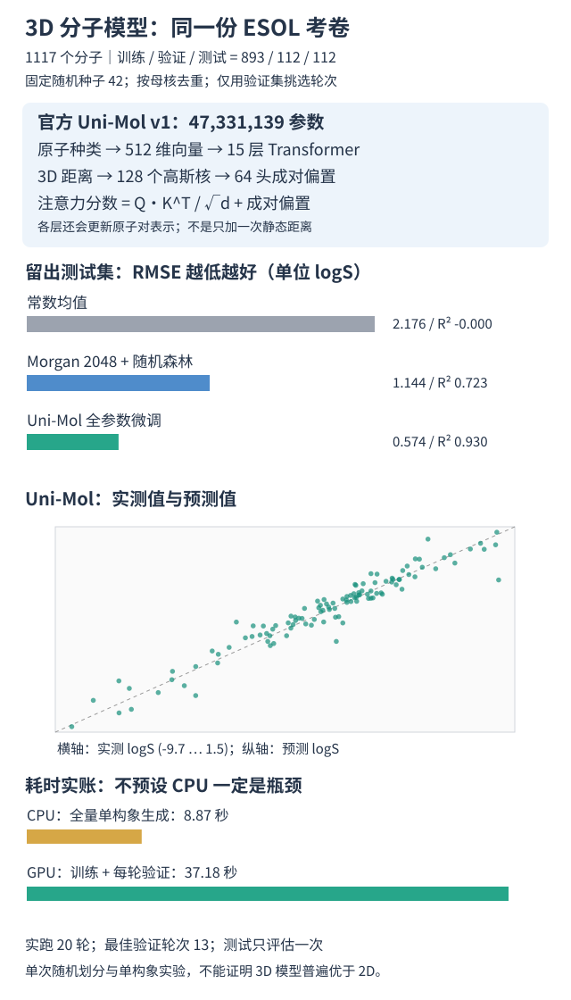

# AI for Science：从科学库到专有模型与 CUDA 科学计算

生成时间：2026-11-23T23:32:52+08:00。全部数值来自本目录 JSON 与训练日志；未把预设结论当结果。设备为 DGX Spark / NVIDIA GB10，Python 3.12 / CUDA 13.0 / PyTorch 2.14.1+cu130。

## 实测结论

四个模块均完成：真实 ESOL/BBBP 清洗、RDKit 三维构象、官方 Uni-Mol 全参数微调、原版 cuSpa 源码编译及 CPU/GPU 正确性比较、cuPotential 源码审计，以及科研 Skill 与一键入口。

- Uni-Mol 本次 ESOL 留出测试 RMSE 0.5738，Morgan RF 1.1442；这是一次同划分实验，不能归因成“纯3D收益”或普遍基准。
- cuSpa 设备驻留稳态流程 28.26×、仅查询 156.10×；加入一次输入传输的估算约 11.28×，尚不包含输出回传。
- CPU 全量单构象 8.870s，GPU 20轮训练及每轮验证 37.183s。这次 CPU 构象没有比训练更慢；1000分子×10构象单核则为66.608s，工作量改变会改变瓶颈。

## 1. RDKit：字符串 → 合法结构 → 描述符 → 三维坐标

真实数据取自 [ESOL](https://deepchemdata.s3-us-west-1.amazonaws.com/datasets/delaney-processed.csv) 与 [BBBP](https://deepchemdata.s3-us-west-1.amazonaws.com/datasets/BBBP.csv)。原始 CSV、清洗表均保留于 `data/`，SHA256 与来源在 `results/module1_results.json`。

- ESOL：1128条，合法1128条，清洗与描述符0.335s。
- BBBP：原CSV 2050条，合法2039条，拒绝11条，清洗与描述符0.875s。常见“2039个”指本次有效条数，不能误称原文件只有2039行。
- `MolFromSmiles`拦截非法五价碳；`SaltRemover`去盐再保留最大重原子片段。示例`.Cl`是非标准化脏记录；去盐不等于完成电离态、互变异构和完整盐型标准化。
- ETKDGv3生成候选几何，加显式氢后用MMFF94优化，输出移除氢后的坐标与欧氏距离矩阵。固定种子20261123，每个worker使用单线程。

| 分子数 | 每分子请求构象 | CPU进程数 | 实测墙钟秒 | 生成构象数 | MMFF收敛构象数 |
|---:|---:|---:|---:|---:|---:|
| 1000 | 1 | 1 | 7.961 | 1000 | 883 |
| 1000 | 1 | 8 | 1.146 | 1000 | 883 |
| 1000 | 10 | 1 | 66.608 | 10000 | 8870 |
| 1000 | 10 | 8 | 9.987 | 10000 | 8870 |

MMFF最多200次迭代；“成功生成”与“优化已收敛”分开计数。训练缓存采用每个分子第一个生成的构象，未按标签选择，仍包含未在200步内收敛的候选，因此不能称为全部已收敛的实验结构。8进程与单进程为实测墙钟，不是把累计CPU时间除以核数。

| 药物（图示中性母体） | MW | RDKit LogP | TPSA / Ų |
|---|---:|---:|---:|
| 苯海拉明 | 255.36 | 3.35 | 12.47 |
| 非索非那定 | 501.67 | 5.51 | 81.00 |
| 氯雷他定 | 382.89 | 4.89 | 42.43 |
| 西替利嗪 | 388.90 | 3.15 | 53.01 |
| 阿司匹林 | 180.16 | 1.31 | 63.60 |
| 咖啡因 | 194.19 | -1.03 | 61.82 |
| 布洛芬 | 206.28 | 3.07 | 37.30 |

非索非那定已按PubChem CID3348核对并修正结构，MW501.67；原手写式多两个碳的529.72错误不进入最终图。全部药物身份核对记录在 `results/drug_structure_audit.json` 与 `data/pubchem/`。LogP为所画中性结构的模型描述符，不是生理pH下logD。TPSA90不是不可穿脑硬阈值；P-gp外排、电离状态等也参与，二代也不能笼统说绝无嗜睡。

真实分子案例：ESOL原始行48，nifedipine（硝苯地平）；重原子编号1与24相隔7根键，ETKDG+已收敛MMFF94候选几何中距离3.453Å。XYZ与完整距离矩阵保存于 `results/folded_molecule_distance.npz`，原子索引从0开始。这是模型生成构象，不是实验测量。


## 2. 官方 Uni-Mol：真实预训练模型微调

源码为 [deepmodeling/Uni-Mol](https://github.com/deepmodeling/Uni-Mol)，commit见 `results/provenance.json`。本次加载官方2022 no_h预训练权重，来源及SHA256存于 `results/module2_results.json`，权重缓存在 `weights/`。

实际网络为 **47,331,139参数，15层，512维，2048维FFN，64注意力头，128个高斯核**。本次不是84M Uni-Mol2。完整网络打印 `results/unimol_architecture.json`。

原子种类 → token向量；原子对类型调制的距离 → 128高斯通道 → 投影为64头成对偏置；注意力分数为 `QKᵀ/√d + pair_bias`。官方实现还在各层传播、更新成对表示，不只是静态重复加初始距离。距离保留旋转/平移不变性；完整机制可沿源码查看。

ESOL1128行先按清洗canonical母核去重为1117个，再固定seed42随机80/10/10，train/val/test为[893, 112, 112]。同一分子不跨集合，全部三模型用同一测试集；具体原行与结构保留在 `results/module2_split.json`。回归标签标准化仅拟合train。RF400树，Morgan半径2/2048位。Uni-Mol所有参数训练，batch32，AdamW lr1e-4，cosine调度，BF16 autocast/FP32权重和优化器，workers0。

| 模型 | 测试RMSE（logS） | MAE | R² |
|---|---:|---:|---:|
| 训练集均值 | 2.1757 | 1.6646 | -0.0003 |
| Morgan 2048 + RF | 1.1442 | 0.8203 | 0.7234 |
| 官方 Uni-Mol 全参数微调 | 0.5738 | 0.4120 | 0.9304 |

20轮逐轮训练Loss/验证指标与耗时在 `results/module2_epochs.jsonl`，仅用validation RMSE选第13轮checkpoint；最终test仅评估一次。最佳模型为 `results/unimol_esol_best.pt`。训练及逐轮验证墙钟 37.183s；CPU全1128单构象 8.870s；Torch峰GPU分配 2.234GiB。

范围：只对ESOL做回归训练，BBBP完成真实清洗与结构展示，本次未训练BBBP分类器，因而没有捏造ROC-AUC。单seed随机划分不是scaffold外推；预训练重叠尚未审计；预训练、模型容量与3D共同变化，无法把全部差异归因3D，要做距离打乱/二维坐标消融才能分开。



## 3. cuSpa / cuPotential：库内部在算什么

### cuSpa：原核编译与正确性

原仓 `cuspa/` 的11个C++/CUDA源头文件合计2378行，并非一个2378行CUDA文件。用nvcc13与CMake编译sm_121成功，配置/编译日志在 `results/cuspa_build_*.log`。基准脚本直接调用官方索引、射线查询、CUB聚合核；没有用替代PyTorch算法假装cuSpa。

固定种子合成 **50,000个八边形×2,000,000点×500种基因**。这是空间组学量级的合成算力负载，不是患者组织。匹配793,204点、CSR非零780,563项。CPU/GPU均float64，全部200万归属与整个CSR计数矩阵均零差异。

| 阶段 | CPU毫秒 | GPU毫秒 |
|---|---:|---:|
| 网格索引 | 2.168 | 3.277 |
| 射线查询 | 236.064 | 1.512 |
| CSR聚合 | 34.043 | 5.965 |
| 设备驻留流程 | 272.274 | 9.636 |

CPU为单线程Numba编译后的同类网格+射线算法，聚合NumPy sort/unique；CPU流程数为各阶段中位数相加，GPU为整体流程中位数。GPU同步后墙钟计时，输入已驻留设备，**28.26×**；单查询**156.10×**。输入传输另实测14.502ms，传输+稳态流程相加约24.138ms，对CPU约11.28×；这是组合估算，输出回传未计。不是对多线程CPU或真实复杂组织的普遍倍数。

源码机制是AABB网格过滤 → 水平射线奇偶判定 → `(细胞ID,基因ID)`64位编码 → CUB radix sort / run-length encode → CSR。**atomicAdd用于网格候选计数，非细胞×基因矩阵聚合。**源码未检出mma/wmma/tcgen05/内联PTX；仍依赖CUDA runtime、CUB与绑定设备检查，已用HIP/hipCUB移植并在RX9070XT完成本负载的完整逐字节验证，详情见模块五。

初次float32有16个归属差异，保留失败记录；未删点，统一双方float64后完整重测零差异。精确浮点/边界差异根因未逐点定位，不能说已完全修复float32。当前高层聚合要求CuPy，我们用官方原生 `_core.aggregate_to_cells` 接Torch CUDA buffer。

### cuPotential：开源部分有实质工作，核心运行时专有

本地clone有233 tracked文件，62个C++/CUDA头源文件共16650行。根LICENSE区分Apache2.0 OpenMM插件与NVIDIA专有API/libcupo.so/LTO-IR数学对象。clone无libcupo.so，构建fetch release，wheel可打包运行时。

公开代码包括融合Langevin积分/约束链（SETTLE/SHAKE）、GroupedBonded、barostat与非键桥接。`CudaNonbondedKernels.cu`通过`cupo_cell_list_create`、`cupo_dspace_create`、`cupo_kspace_create`等把关键非键作用交给专有libcupo。不能称“全是空壳”，也不能说整个核心可从本clone完整重建。这里完成源码审计，没有运行cuPotential分子动力学。

逐文件行数、专用指令搜索与许可证据见 `results/module3_source_audit.json`、`MODULE3_NOTES.md`。


## 4. 科研 Skill 与一键复现

`skill/ai4s-mol-skill/SKILL.md`已通过skill-creator校验，围绕实际脚本、数据来源与失败口径组织。入口在仓库根目录执行：

```bash
.venv/bin/python run_pipeline.py
```

会顺序执行RDKit、Uni-Mol、cuSpa，每个子进程由统一内存看护包裹；整条重跑会产生新计时并覆盖对应结果。只核对现存结果而不重跑训练/测速：

```bash
.venv/bin/python run_pipeline.py --reuse-results
```

后一命令仅校验已有JSON并写manifest，不能宣称新实验。也可`--modules rdkit unimol`选择模块。报告汇编命令：`.venv/bin/python build_report.py`。环境复现细节见三个MODULE_NOTES；当前.venv借用本机基础包路径，换机器需按 `results/environment_freeze.txt` 和源码构建记录重建，不是独立可搬运环境。

全部4张SVG为640px单栏、纯白底、WenQuanYi Micro Hei，均经CairoSVG转PNG并实际目检。PNG是自检预览，SVG为展示原稿。

统一内存看护每250ms读取MemAvailable，低于20GiB终止整个子进程组：

- module2：最低可用统一内存 107.197 GiB，退出码 0，看护未触发。
- module3：最低可用统一内存 111.016 GiB，退出码 0，看护未触发。

## 核心工程结论链条

1. 分子数据入库先验证结构并保留盐型语义，再算描述符；结构不是一个随手写的字符串，非索非那定的错误式会让MW多28。
2. CPU生成候选三维几何，把坐标转成旋转/平移不变的距离，再由专有Transformer做性质预测；GPU训练已真实完成，不是只调用远程API。
3. 同一个模型优势要用同考卷验证：去重母核、固定留出、validation挑轮次、test一次。本次Uni-Mol胜出，但不能说已经证明纯3D因果优势。
4. 科学计算加速先讲算法和计时范围：cuSpa是空间过滤、几何分支和整数排序，不需Tensor Core；28倍驻留流程与含传输估算11倍是不同口径。
5. 库的开源边界看许可、源码和动态依赖：cuPotential的公开融合核有价值，核心libcupo仍是专有。Skill负责串联这些可执行步骤和证据，不凭提示词制造实验结果。

## 文件索引

- `exp1_rdkit_data_processing.py` / `MODULE1_NOTES.md`：真实数据、描述符、1/10构象计时与图1/2。
- `exp2_unimol_finetune.py` / `MODULE2_NOTES.md`：官方模型、预训练权重、全参数训练、同测试集指标与图3。
- `exp3_cudax_cuspa_benchmark.py` / `MODULE3_NOTES.md`：原版CUDA编译基准与审计；`render_module3.py`重绘图4。
- `results/`：split、逐轮日志、测试预测、原始时间数组、结构审计、来源版本、最优checkpoint。
- `logs/`：内存看护；`DevHistory.md`：实际命令、错误与修复；`visuals/`：四张SVG和PNG。


## 5. AMD RX 9070 XT：HIP 真机移植与逐字节对账

2026-11-23通过`ssh amd9070`连接Windows机器，在`C:\AI4S-HIP-Lab`独立目录编译执行，复用既有ROCm10.2工具链与vcvars64，没有修改Strata工程。GPU启动前检查进程，无游戏本体进程；未终止Steam/修改器/模拟器后台。

移植源码在`amd_hip_port/`：保留原版Apache2.0几何/网格/聚合核，机械转换CUDA runtime→HIP与CUB→hipCUB，保留64位键排序、游程编码、CSR算法。独立C++入口绕过nanobind而不重写算法；translation_manifest记录源/目标哈希。并非把整个Python包原样移植，也没有复刻cuPotential专有运行时。

同种子20261123的输入由Spark一次生成后原字节传输：float64，50000八边形、2000000点、500基因。二进制输入与哈希在`results/module5_data/`。避免Windows与Linux各自随机生成的差异。

| 阶段（同步墙钟中位数） | NVIDIA GB10 同源C++ / ms | AMD RX9070XT 同源C++ / ms |
|---|---:|---:|
| 网格包围盒索引 | 1.6586 | 2.3869 |
| 水平射线查询 | 1.5198 | 0.9207 |
| 排序/游程/CSR聚合 | 5.5638 | 3.7683 |
| 完整设备驻留流程 | 5.7599 | 6.0502 |
| 输入H2D（单次） | 0.8783 | 11.6143 |
| 输出D2H（单次） | 0.2971 | 1.5167 |

同源C++均3次预热、7次稳态重复，同时记录GPU event和host wall，以同步墙钟为主。禁用FMA contraction（CUDA --fmad=false / HIP -ffp-contract=off），不启用fast math。原始数组和冷启动保留在JSON。各阶段是分开运行的中位数，不应相加冒充完整流程。

原图CPU272.274ms与GB10 Python9.636ms保留；新增AMD HIP6.050ms。因为Python和C++入口及分配/验证路径不同，**不能拿9.636对6.050就说AMD比GB10快**；同源入口GB10为5.760ms、AMD6.050ms，当前硬件、OS和驱动下相近。两台机器平台与FP64吞吐不同，这不是通用GPU排名。

AMD H2D 11.6143ms，驻留6.0502ms，D2H 1.5167ms。三段相加约19.1812ms为组合估算，不是额外独立端到端实测。CPU对AMD驻留约45.00倍，也只适用于本合成负载与单线程编译CPU基线。

### 正确性：全量逐值且逐字节一致

- 所有2000000个point cell_id：0 mismatch。
- CSR行指针50001项、列索引780563项、计数780563项：全部0 mismatch。
- 四个输出裸int32数组与原版GB10 Python库、同源GB10 C++结果均逐字节一致；匹配点793204，CSR非零780563。
- 不声称GPU内部每一步浮点中间值逐位一致；严格相同的是最终整数归属和完整canonical CSR。

| 输出 | GB10与AMD一致的SHA256 |
|---|---|
| assignment | `f5ae2379e529ec834bca3d721c6590c1417e7157251e8a7bc6929e723f656099` |
| indptr | `200f0098261371dd71b39614bd1f38d66debbb18ecba73ff4971fed45c07509c` |
| indices | `922e893643c2f3f4ac9a546434212e9963e4703ec48146ffc447a6d66ae1b84a` |
| data | `c3771ef663e8af44edc6bc88d0141153c9b91f2d684d0846ba5820465db72a52` |


验证脚本：`.venv/bin/python compare_module5_outputs.py`。汇总为`results/module5_amd9070_results.json`，全量对账为`results/module5_comparison.json`，AMD原始输出与计时为`results/module5_amd9070/`，GB10同源计时为`results/module5_gb10_cpp/`。

本次已证明这些cuSpa通用算术/分支/排序核能够在gfx1201原生执行，未使用Tensor Core。图纸的分子非键势能加分项未做，不把这次成功扩大成已移植cuPotential或全部CUDA-X科学库。图4已加入三方条形图、同源入口对照与完整正确性口径。
